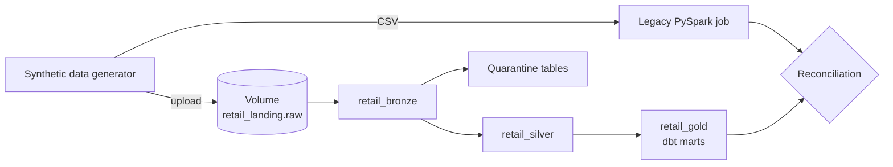

# Spark to Databricks Migration

A case study in migrating a legacy batch PySpark ETL for a fictional Malaysian retailer to a Databricks Lakehouse built on Lakeflow Declarative Pipelines, Delta Lake, Unity Catalog and dbt Core, with GitHub Actions for continuous integration.

**Status:** Phase 00 (foundation) is written and awaiting review. Nothing in this repository has been executed or validated yet. Results are added only from recorded runs.

## What the project demonstrates

- Rebuilding a full-overwrite batch job as incremental, idempotent ingestion with Auto Loader and change-data-capture upserts.
- Explicit data quality: declared rules, quarantine tables with failure reasons, and observable counts.
- Clear tool ownership: Lakeflow for bronze and silver, dbt Core for gold marts.
- Proving correctness by reconciling legacy and modern outputs on identical, deterministic synthetic data.
- Running on Databricks Free Edition with documented assumptions and fallbacks.

## Architecture at a glance



| Layer | Schema | Owner |
|---|---|---|
| Landing | `retail_landing` (volume `raw`) | Manual upload |
| Bronze | `retail_bronze` | Lakeflow pipeline |
| Silver and quarantine | `retail_silver` | Lakeflow pipeline |
| Gold | `retail_gold` | dbt Core |

Full design: [docs/architecture.md](docs/architecture.md).

## Phases

| Phase | Scope | Status |
|---|---|---|
| 00 | Foundation: architecture, contracts, ADRs, conventions | Written, pending review |
| 01 | Synthetic data generation and data contracts | Not started |
| 02 | Legacy PySpark job | Not started |
| 03 | Lakeflow bronze and silver | Not started |
| 04 | dbt gold marts | Not started |
| 05 | Orchestration and CI/CD | Not started |
| 06 | Reconciliation and resilience | Not started |
| 07 | Benchmark and portfolio | Not started |

Each phase folder under `phases/` contains the phase brief (`PROMPT.md`), a design explanation, a manual runbook, a validation checklist and a handoff note.

## Repository layout

Directories are created by the phase that first needs them.

```
.
├── README.md
├── GLOBAL_MASTER_INSTRUCTIONS.md   Project-wide working rules
├── .gitignore
├── .env.example                    Variable names only; copy to .env locally
├── docs/
│   ├── case_study.md               Scenario, goals, acceptance criteria
│   ├── architecture.md             Target architecture and diagrams
│   ├── data_contracts.md           Contract framework and quality rules
│   ├── platform_assumptions.md     Free Edition, cost, toolchain, responsibilities
│   └── adr/                        Architecture decision records
├── infra/sql/                      Workspace setup SQL (00)
├── data/                           Generator, contracts, samples (01)
├── legacy_spark/                   Legacy batch job (02)
├── lakeflow/                       Pipeline source (03)
├── dbt/                            dbt project (04)
├── .github/workflows/              CI (05)
├── reconciliation/                 Legacy versus modern checks (06)
├── benchmarks/                     Harness and recorded results (07)
├── tests/                          Unit tests
└── phases/                         Per-phase briefs and documentation
```

## Getting started

Follow [phases/phase_00_foundation/MANUAL_RUNBOOK.md](phases/phase_00_foundation/MANUAL_RUNBOOK.md).

## Documentation

- [Case study, goals and acceptance criteria](docs/case_study.md)
- [Target architecture](docs/architecture.md)
- [Data contracts](docs/data_contracts.md)
- [Platform and cost assumptions](docs/platform_assumptions.md)
- [Architecture decision records](docs/adr/README.md)

## Security

Never commit `.env`, `profiles.yml`, `~/.databrickscfg`, tokens or bulk generated data. The `.gitignore` covers these; each runbook includes a scan of staged changes before pushing.

## Limitations

Databricks Free Edition is a non-commercial environment with quotas and no SLA. Nothing here implies production readiness; see the demo versus production table in [docs/case_study.md](docs/case_study.md).

## License

To be chosen before publication (Phase 07).
