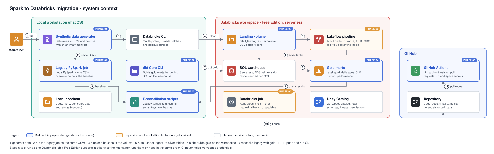
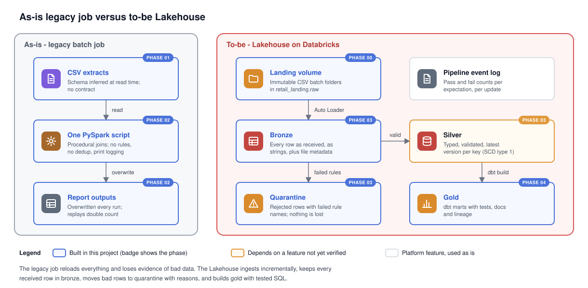
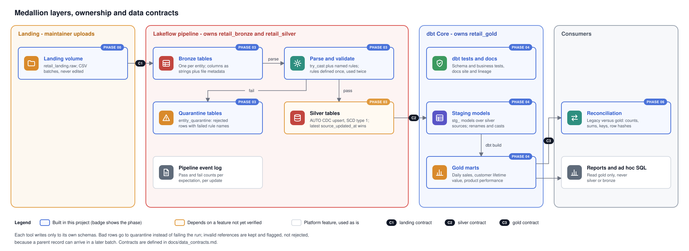
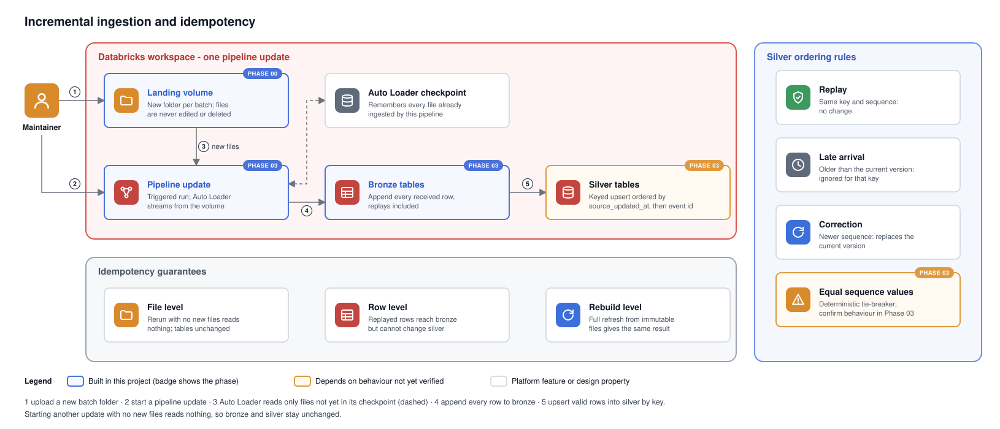
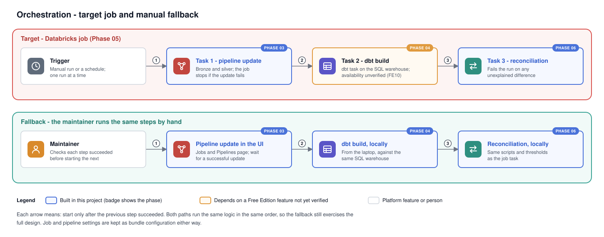
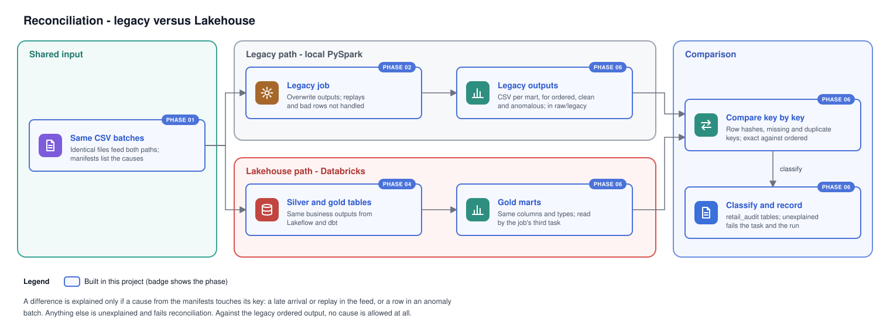

# Target Architecture

Status: proposed in Phase 00, pending human review. Product names and APIs flagged "verify" must be checked against current Databricks documentation before the phase that uses them.

## 1. System context

Diagrams in this repository are hand-written SVG files under `docs/diagrams/`. Card borders follow one legend everywhere: blue for components built in this project (the badge names the phase), orange for components that depend on a Free Edition feature or behaviour not yet verified, grey for platform services used as is.

The same generated CSV files feed both the legacy job (locally) and the Lakehouse (through the volume). That shared input is what makes reconciliation meaningful.

## 2. As-is versus to-be

| Aspect | As-is | To-be |
|---|---|---|
| Processing model | Full reload every run | Incremental file ingestion with checkpoints |
| Schema | Inferred at read | Declared contract; bronze tolerant, silver strict |
| Bad records | Silently dropped or propagated | Quarantined with reason, counted |
| Duplicates and replays | Double counted | Collapsed by key and sequence |
| Late or corrected records | Require full re-extract | Applied by sequence ordering |
| Business logic | Procedural Python | dbt SQL models with tests and lineage |
| Storage | Files or overwritten tables | Delta tables governed by Unity Catalog |
| Operations | Manual, print logging | Pipeline event log, job runs, CI checks |

## 3. Medallion layers and ownership

| Layer | Schema | Owner | Content | Write pattern |
|---|---|---|---|---|
| Landing | `retail_landing` (volume `raw`) | Maintainer (manual upload) | Immutable CSV files, one folder per batch | Add files only; never edit or delete during a demo run |
| Bronze | `retail_bronze` | Lakeflow pipeline | Every source row as received, all business columns as strings, plus ingestion metadata | Append-only streaming tables |
| Silver | `retail_silver` | Lakeflow pipeline | Typed, validated, current-state rows (SCD type 1) keyed by business key | Change-data-capture upsert ordered by source sequence |
| Quarantine | `retail_silver` (`<entity>_quarantine`) | Lakeflow pipeline | Rows that failed validation, with the failed rule names | Append-only |
| Gold | `retail_gold` | dbt Core | Daily sales, customer lifetime value, product performance | dbt table materialisation (full rebuild); incremental only if justified in Phase 04 |

Ownership rule: no tool writes to a schema it does not own. dbt reads silver through `source()` declarations and never writes to bronze or silver. The Lakeflow pipeline never publishes gold tables. This avoids two systems maintaining the same table, which is the most common cause of conflicting logic in mixed Lakeflow and dbt estates. See ADR 0001.

## 4. Naming conventions

| Object | Convention | Example |
|---|---|---|
| Catalog | Configurable, default `workspace` | `workspace` |
| Schemas | `retail_<layer>` | `retail_bronze` |
| Bronze and silver tables | Entity name, plural, snake_case | `retail_silver.orders` |
| Quarantine tables | `<entity>_quarantine` | `retail_silver.orders_quarantine` |
| dbt staging models | `stg_<entity>` | `stg_orders` |
| dbt marts | `mart_<subject>` | `mart_daily_sales` |
| Ingestion metadata columns | Leading underscore | `_ingested_at`, `_source_file` |
| Business columns | snake_case, matching the data contract | `source_updated_at` |
| Landing paths | `/Volumes/<catalog>/retail_landing/raw/<batch_folder>/<entity>.csv` | `/Volumes/workspace/retail_landing/raw/initial/orders.csv` |

Exact batch folder names are fixed in Phase 01. Where staging models are materialised (view in `retail_gold` or a separate schema) is decided in Phase 04; dbt's default behaviour of prefixing custom schema names with the target schema will need a `generate_schema_name` override so that marts land in exactly `retail_gold`.

## 5. Incremental processing and idempotency

Idempotency is provided at three levels:

1. **File level.** Auto Loader records processed files in the pipeline checkpoint. Re-running the pipeline without new files reads nothing. Re-uploading a file under an already processed path is not reprocessed by default (verify the `cloudFiles.allowOverwrites` default in Phase 03). This is why landing files are treated as immutable.
2. **Row level.** Replayed or duplicate rows that arrive in a new file do land in bronze (bronze is a faithful record of what was received), but the silver upsert is keyed on the business key and sequenced by `source_updated_at` with a deterministic tie-breaker, so a replay cannot change silver state.
3. **Rebuild level.** A pipeline full refresh rebuilds bronze and silver from all files in the volume and must produce the same result as the incremental history. dbt gold tables are rebuilt in full on every run, so they are idempotent by construction.

Late arrivals: a record whose `source_updated_at` is older than the current silver version is ignored for that key. Corrections: a record with a newer `source_updated_at` replaces the current version. Deletes are not modelled as physical deletes; cancellations are status changes (to be confirmed in Phase 01).

Silver keeps current state only (SCD type 1). History remains available in bronze for audit and replay. SCD type 2 for customers is a documented optional extension, not part of the baseline, because the legacy job only produces current state and reconciliation would gain nothing from it.

API note (verify in Phase 03): the CDC upsert is expected to use Lakeflow AUTO CDC (`create_auto_cdc_flow` in Python, `AUTO CDC INTO` in SQL; formerly `apply_changes` / `APPLY CHANGES INTO`). The current Python module is expected to be `from pyspark import pipelines as dp`, with the older `import dlt` still accepted. Databricks has renamed this product more than once; documentation may now refer to it as Lakeflow Spark Declarative Pipelines. Tie-breaking behaviour when two rows share the same sequence value must be confirmed against documentation and tested.

## 6. Validation and quarantine

The validation step is the "Parse and validate" card in the medallion diagram (section 3): each bronze row is parsed with `try_cast` and `try_to_timestamp`, then either passes every rule into the silver CDC flow, or goes to quarantine with its original values, failed rule names and file metadata.

- Rules are defined once (a single dictionary of rule name to SQL predicate) and used twice: as `expect_all_or_drop` on the path into silver, and negated to select rows into the quarantine table. This is the documented Lakeflow quarantine pattern and keeps both sides consistent.
- Expectation metrics in the pipeline event log give per-rule pass and fail counts without extra code.
- `expect_or_fail` is reserved for conditions that mean the run itself is wrong (for example, a file with no recognisable header), not for individual bad rows.
- Referential integrity (an order whose customer does not exist yet) is not a silver rejection rule, because a parent can legitimately arrive in a later batch. Orphans are kept and flagged, tested in dbt, and reported in reconciliation. See `data_contracts.md`.

## 7. Gold layer

dbt Core with the `dbt-databricks` adapter connects to a SQL warehouse over HTTPS from the maintainer's machine (or from a Databricks job task in Phase 05, if available in Free Edition). Planned marts:

| Mart | Grain | Primary measures |
|---|---|---|
| `mart_daily_sales` | One row per local business date (Asia/Kuala_Lumpur) | Order count, item quantity, gross sales, successful charges, refunds, net payments |
| `mart_customer_lifetime_value` | One row per customer | First and last order date, order count, total spend |
| `mart_product_performance` | One row per product | Units sold, revenue, order count |

Refunds and partial payments are modelled explicitly (see `data_contracts.md`, payments). The treatment of cancelled orders and the final measure definitions are set in Phase 01 (business rules) and Phase 04 (SQL).

## 8. Execution environments and responsibilities

| Activity | Where | Who triggers | Credentials needed |
|---|---|---|---|
| Generate synthetic data | Local Python | Maintainer | None |
| Run legacy job | Local PySpark (needs Java) | Maintainer | None |
| Unit tests | Local, and GitHub Actions | Maintainer, CI on pull request | None |
| Upload CSVs to volume | Workspace UI or Databricks CLI | Maintainer | Workspace login |
| Run Lakeflow pipeline | Workspace, serverless | Maintainer (UI) or job | Workspace login |
| Build gold with dbt | Local dbt CLI to SQL warehouse, or job task | Maintainer | Token or OAuth, stored only in local `.env` or profile |
| Reconciliation | Local scripts plus SQL in workspace | Maintainer | As for dbt |
| Deployment of job and pipeline definitions | Databricks CLI bundle commands | Maintainer, manually | Workspace login |

GitHub Actions never holds workspace credentials in the baseline design. If live deployment from CI is added later, it must be a separate, manually approved workflow using GitHub environment secrets. See ADR 0005.

## 9. Orchestration

Target (Phase 05, subject to Free Edition verification):

Fallback: the maintainer runs the same three steps by hand in order (pipeline update in the UI, `dbt build` locally, reconciliation scripts locally). The order and the success check between steps are identical, so the fallback exercises the same logic.

Job and pipeline definitions are planned as Databricks Asset Bundle configuration (`databricks.yml`). The Phase 05 brief refers to these as Declarative Automation Bundles; confirm the current product name and CLI syntax before Phase 05.

## 10. Reconciliation

Expected differences are a feature, not a defect: for example the legacy job double counts replayed records while the Lakehouse does not. Every expected difference must trace back to an entry in the anomaly manifest (Phase 01) and a rule in the data contract. Unexplained differences fail reconciliation. Details in Phase 06.

## 11. Security and secrets

- Credentials exist only in the maintainer's local `.env`, `~/.databrickscfg` or GitHub environment secrets. All are git-ignored or outside the repository.
- `.env.example` documents variable names with placeholder values only.
- dbt `profiles.yml` is git-ignored; a `profiles.example.yml` using `env_var()` will be committed in Phase 04.
- Prefer OAuth (`databricks auth login`) over long-lived personal access tokens where the tool supports it.
- Before every push, the maintainer scans staged changes for tokens (command in each phase runbook).

## 12. Failure and recovery

| Failure | Recovery path | Verified in |
|---|---|---|
| Bad batch uploaded | Remove the batch folder before the next update; if already ingested, full refresh after removal | Phase 06 |
| Schema drift in a source file | Bronze tolerates (new columns or rescued data); silver selects contracted columns only; contract version bump to adopt | Phase 03, 06 |
| Silver logic bug | Fix code, pipeline full refresh from immutable landing files | Phase 06 |
| Gold logic bug | Fix model, `dbt build`; prior versions available via Delta time travel on dbt-owned tables | Phase 04, 06 |
| Checkpoint corruption | Full refresh of the affected table | Phase 06 |

Manual DML or `RESTORE` against pipeline-managed tables is avoided; recovery for those goes through the pipeline. Confirm current guidance in Phase 06.

## 13. Open questions requiring verification

Tracked with fallbacks in `platform_assumptions.md`. The main ones:

1. Whether a single pipeline can publish to both `retail_bronze` and `retail_silver` by fully qualified name. Fallback: one schema for both layers with `bronze_` and `silver_` table name prefixes.
2. Whether the dbt task type is available in Free Edition jobs. Fallback: run dbt locally.
3. Whether bundle deployment works against Free Edition. Fallback: create the job and pipeline in the UI from the documented settings.
4. Current names and signatures of the Lakeflow Python API and AUTO CDC.
