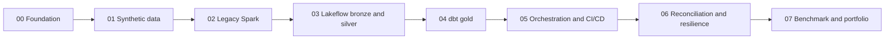

# Case Study: Legacy PySpark ETL to a Databricks Lakehouse

## 1. Scenario

A fictional Malaysian retailer sells across physical stores and an online channel. Every night a single PySpark batch job reads CSV extracts from the order management system (customers, products, orders, order items, payments), joins them, and overwrites a set of reporting tables used for daily sales, customer value and product performance reporting.

All data in this project is synthetic and generated deterministically (Phase 01). No real customer, product or payment data is used at any point. Currency is Malaysian Ringgit (MYR).

## 2. Problems with the legacy job

The legacy job (built deliberately in Phase 02 to represent a common real-world starting point) has these characteristics:

| Problem | Operational consequence |
|---|---|
| Full overwrite of every output on every run | A failed run can leave reports empty or half written; no history; every run reprocesses everything. |
| Schema inferred from CSV at read time | A new or renamed column silently changes types or breaks downstream joins. |
| No data quality rules | Null keys, negative amounts and malformed timestamps flow into reports or are dropped by joins without a trace. |
| No deduplication strategy | Replayed extracts double-count revenue. |
| No incremental semantics | Late or corrected records are only picked up if the full extract is re-sent. |
| Procedural transforms with hard-coded paths | Hard to test, hard to review, environment-specific. |
| Print-style logging, manual scheduling | No lineage, no run history, no alerting. |
| No reconciliation | Nobody can prove that a report total matches the source. |

## 3. Goals

| ID | Goal |
|---|---|
| G1 | Reproduce the legacy job's business outputs on a Lakehouse architecture with clear layer ownership. |
| G2 | Make ingestion incremental and idempotent: re-running with no new input changes nothing; replayed input does not double-count. |
| G3 | Make data quality explicit: every rule is declared, every rejected record is kept in quarantine with a reason, and counts are observable. |
| G4 | Prove correctness by reconciling legacy and modern outputs with documented, explained differences. |
| G5 | Keep business marts in version-controlled, tested SQL (dbt) with lineage and documentation. |
| G6 | Automate static checks and unit tests on every change without requiring workspace credentials in CI. |
| G7 | Run end-to-end on Databricks Free Edition where feasible, with documented fallbacks where it is not. |
| G8 | Present an honest portfolio: every published result is backed by a recorded run. |

## 4. Non-goals

- Production SLAs, high availability, disaster recovery across regions or multi-workspace promotion. Free Edition is not a production platform.
- Streaming latency targets. Pipelines are triggered (batch-style) runs.
- Real payment processing, PII handling programmes or regulatory compliance (all data is fictional).
- Fine-grained access control design beyond a single developer workspace. The production hardening section notes what would change.
- Cost optimisation claims in currency. Free Edition has no billing; see `platform_assumptions.md`.

## 5. Acceptance criteria (project level)

Each criterion names the phase that delivers it and the evidence the maintainer records. A criterion is only marked met when that evidence exists.

| ID | Criterion | Phase | Evidence |
|---|---|---|---|
| AC1 | Running the generator twice with the same seed, as-of date and preset produces byte-identical files. | 01 | Checksums from two runs. |
| AC2 | Clean baseline data passes all declared contract checks; each anomaly scenario is produced only when enabled and is listed in a machine-readable manifest. | 01 | Validator output, anomaly manifest. |
| AC3 | The legacy job runs locally on the generated data and writes baseline outputs plus baseline reconciliation metrics. | 02 | Run log, output listing. |
| AC4 | The Lakeflow pipeline ingests the initial snapshot and at least three incremental batches into bronze and silver. | 03 | Pipeline event log, table counts. |
| AC5 | Re-running the pipeline with no new files produces no change in silver row counts or totals; re-uploading a replayed batch does not change silver totals. | 03, 06 | Before/after counts and sums. |
| AC6 | Every anomaly in the manifest is accounted for as quarantined, deduplicated, flagged or explained, and counts match the manifest. | 03, 06 | Quarantine counts vs manifest. |
| AC7 | dbt builds the gold marts from silver only, and all schema and business tests pass. | 04 | `dbt build` output, docs site. |
| AC8 | Ownership is enforced: Lakeflow writes only `retail_bronze` and `retail_silver`; dbt writes only `retail_gold`. | 03, 04 | Code review, table listing per schema. |
| AC9 | GitHub Actions runs static checks and unit tests on pull requests with no workspace secrets. | 05 | Workflow run link. |
| AC10 | Legacy and modern outputs reconcile: row counts and decimal totals match exactly on clean data; every difference on anomalous data is explained by a documented rule. | 06 | Reconciliation report. |
| AC11 | Rerun, late arrival, schema drift and recovery scenarios are executed and their outcomes recorded. | 06 | Test matrix with evidence. |
| AC12 | Benchmark and portfolio material contains only measured numbers, with environment and caveats stated. | 07 | Benchmark result files. |
| AC13 | No credentials, tokens or private data exist in git history. | All | Secret scan output before each push. |

## 6. Phase plan

| Phase | Delivers | Depends on |
|---|---|---|
| 00 | Architecture, contracts framework, ADRs, repository conventions, workspace namespace | Nothing |
| 01 | Deterministic generator, batches, anomalies, validators, machine-readable contracts | 00 |
| 02 | Legacy PySpark job and baseline metrics | 01 |
| 03 | Lakeflow pipeline for bronze, silver and quarantine | 01, 00 namespace |
| 04 | dbt project for gold marts | 03 |
| 05 | Job definition, bundle configuration, GitHub Actions | 03, 04 |
| 06 | Reconciliation, resilience test matrix | 02, 04 |
| 07 | Benchmark harness, portfolio narrative | All |

Phase 02 deliberately comes before the Lakehouse work: the legacy outputs are the reference that the new platform must reproduce.

## 7. Demo scope versus production hardening

| Concern | This project (demo) | Production would add |
|---|---|---|
| Environments | One Free Edition workspace, one catalog | Separate dev/test/prod workspaces or catalogs, promotion via bundles |
| Identity | Maintainer's own user, OAuth or a short-lived token | Service principals, workload identity federation for CI, no personal tokens |
| Access control | Workspace defaults | Unity Catalog grants per schema, row filters and column masks for PII |
| Landing | Manual upload to a managed volume | External location fed by the source system, file arrival triggers |
| Orchestration | Manual or simple scheduled job | Job with retries, alerts, SLAs, run-as service principal |
| Data quality | Expectations, quarantine tables, dbt tests | Alerting on expectation thresholds, data quality dashboards, owner on-call |
| Recovery | Pipeline full refresh, dbt rebuild, Delta time travel | Documented RPO/RTO, backups of landing data, tested runbooks |
| Cost | Not measurable in currency | Billing system tables, budgets, cluster policies |
| CI/CD | Static checks and unit tests only | Integration tests against a test workspace, gated deployment |
