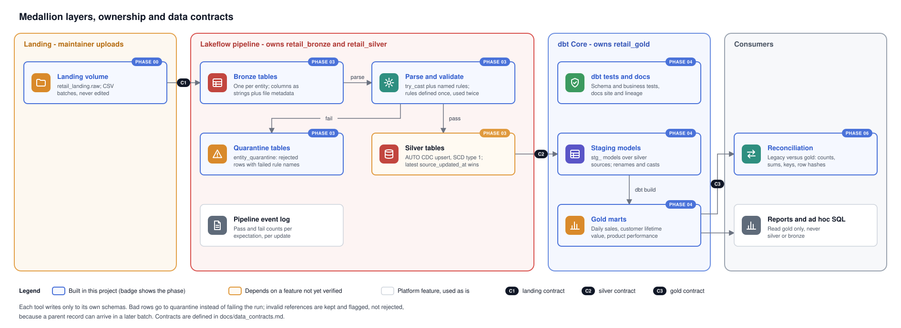
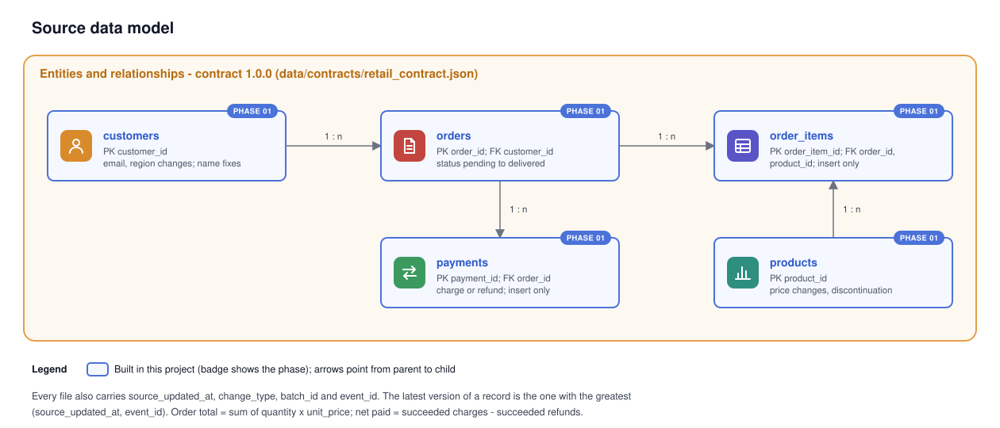

# Data Contracts

Status: the framework was defined in Phase 00. The landing contract C1 was finalised in Phase 01 as `data/contracts/retail_contract.json` (version 1.0.0). The generator, the anomaly injector and the validator all read that file, and Phase 03 is expected to derive its expectations from it. Where this document and the JSON disagree, the JSON wins and this document is updated.

## 1. What a contract means here

A data contract is a written promise from a producer to its consumers about structure (columns, types, nullability), semantics (keys, allowed values, business rules) and delivery (format, frequency, incremental behaviour). Each contract has a version. A change that can break a consumer (removing or renaming a column, tightening a type, changing a key) is a major version change and needs a migration note; adding a nullable column is a minor change.

## 2. Contract boundaries

| Contract | Producer | Consumer | Enforced by |
|---|---|---|---|
| C1 Landing | Source system (the generator) | Lakeflow bronze and the legacy job | Phase 01 validator; bronze is tolerant, so violations surface in silver validation |
| C2 Silver | Lakeflow pipeline | dbt staging models | Lakeflow expectations and quarantine; dbt source tests |
| C3 Gold | dbt | Reporting and reconciliation | dbt schema tests and custom business tests |

Bronze has no contract beyond "every received row is stored with its metadata". That is deliberate: bronze must never reject data, otherwise evidence of a source problem is lost.

## 3. Global conventions (C1)

| Item | Convention | Note |
|---|---|---|
| Format | CSV, comma separated, header row, RFC 4180 quoting, LF line endings | Spark and Auto Loader read LF and CRLF alike; LF keeps diffs clean |
| Encoding | UTF-8 without BOM | |
| Null | Empty field | The string `NULL` is not a null |
| Timestamps | `YYYY-MM-DDTHH:MM:SSZ`, UTC, whole seconds | |
| Business date | Derived from the UTC timestamp in `Asia/Kuala_Lumpur` (UTC+8, no daylight saving) | Daily marts use the local date |
| Money | MYR, written with exactly two decimal places (`12.50`) | Typed as `DECIMAL(18,2)` in silver and gold; never floating point |
| Rounding | Half-up at two decimals | Matches Spark `round()`; the generator sets `ROUND_HALF_UP` explicitly because Python's `decimal` module defaults to half-even |
| Identifiers | `CUST-nnnnnn`, `PROD-nnnnn`, `ORD-nnnnnnn`, `OI-nnnnnnnn`, `PAY-nnnnnnnn` | Assigned once, never reused. Injected anomaly keys contain `X` (for example `ORD-X0110003`) |
| Files | `<dataset>/batch_NNN/<entity>.csv` | `batch_000` is the initial snapshot; `batch_001` onwards are change-feed batches, one per day after the as-of date |

## 4. Entity contracts (C1, carried into C2)

Every file has its entity's business columns (below), followed by four feed columns:

| Feed column | Rule | Meaning |
|---|---|---|
| source_updated_at | Timestamp, required | When the source produced this version. Sequence column for CDC |
| change_type | `snapshot`, `insert`, `update` or `correction` | `snapshot` rows describe state at the as-of cut; the others are change events |
| batch_id | `batch_NNN` | Batch in which the event was first delivered. A replayed row keeps its original value |
| event_id | `EVT-...`, required | Unique per event. A replay repeats it with identical content. Tie-breaker when `source_updated_at` is equal |

**Delivery semantics.** `batch_000` holds one row per record: its latest version before the as-of cut. Each later batch is an append-only change feed of full row images. A record can appear several times in one batch (an order paid, then shipped, on the same day). Consumers take the latest version per primary key, by `(source_updated_at, event_id)`. Valid source behaviour, present in clean data and listed in `_manifest.json`:

- **Late arrival:** an event delivered in a batch after the day it happened. It must not overwrite a newer version.
- **Replay:** an identical row (same `event_id`) re-sent in a later batch. It must not change anything.
- **Correction:** a newer version fixing a value (a lower-case name restored to its proper form).

### customers
| Column | Type | Required | Rule |
|---|---|---|---|
| customer_id | string | Yes | Primary key |
| name | string | Yes | Synthetic only |
| email | string | Yes | Synthetic, on reserved example domains; pattern `local@domain.tld` |
| region | string | Yes | One of the 13 Malaysian states or 3 federal territories |
| created_at | timestamp | Yes | Before any of the customer's orders |
| updated_at | timestamp | Yes | Not before `created_at`; equals `source_updated_at` in this source |

### products
| Column | Type | Required | Rule |
|---|---|---|---|
| product_id | string | Yes | Primary key |
| product_name | string | Yes | Synthetic |
| category | string | Yes | groceries, beverages, household, personal_care, electronics, apparel, home_kitchen, baby, stationery, sports |
| price | decimal | Yes | Greater than zero |
| status | string | Yes | active, discontinued |

### orders
| Column | Type | Required | Rule |
|---|---|---|---|
| order_id | string | Yes | Primary key |
| customer_id | string | Yes | References customers (see section 6) |
| order_date | timestamp | Yes | When the order was placed |
| status | string | Yes | pending, paid, shipped, delivered, cancelled |

### order_items
| Column | Type | Required | Rule |
|---|---|---|---|
| order_item_id | string | Yes | Primary key |
| order_id | string | Yes | References orders |
| product_id | string | Yes | References products |
| quantity | integer | Yes | Greater than zero |
| unit_price | decimal | Yes | Greater than or equal to zero; the product price when the order was placed |

### payments
| Column | Type | Required | Rule |
|---|---|---|---|
| payment_id | string | Yes | Primary key |
| order_id | string | Yes | References orders |
| payment_type | string | Yes | charge, refund |
| amount | decimal | Yes | Greater than zero; direction comes from `payment_type` |
| method | string | Yes | card, fpx, ewallet, bank_transfer |
| status | string | Yes | succeeded, failed |
| payment_at | timestamp | Yes | Not before the order's `order_date` |

### Business rules (checked on the final state)

| Rule | Statement |
|---|---|
| orders.has_items | Every order has at least one item |
| orders.paid_amount_matches | Paid, shipped and delivered orders: succeeded charges equal the order total (sum of quantity times unit_price) |
| orders.cancelled_net_zero | Cancelled orders: succeeded charges minus succeeded refunds is zero |
| orders.pending_not_fully_paid | Pending orders: succeeded charges are below the order total |
| orders.refunds_within_charges | Succeeded refunds never exceed succeeded charges |
| orders.customer_before_order | The customer existed before the order was placed |
| payments.after_order | `payment_at` is not earlier than `order_date` |
| customers.updated_after_created | `updated_at` is not earlier than `created_at` |

#### Refunds and partial payments (decided 2026-10-31)

Both are modelled explicitly.

- **Partial payments.** An order can have any number of payment records. Each successful charge pays part of the order total.
- **Refunds.** A refund is its own payment record with `payment_type = refund` and a positive amount. It references the order, never edits the original charge, and may be partial.
- **Failed payments.** Records with an unsuccessful status are kept in silver but contribute nothing to money totals.
- **Net paid per order** = sum of successful charges minus sum of successful refunds.
- **Payment state per order** (derived in gold, not stored in source): unpaid, partially paid, paid, partially refunded, refunded. Overpaid (net paid greater than the order total) is an anomaly, not a state.

Amounts are always positive and the direction comes from the type column. The alternative, signed amounts, makes sums slightly simpler, but it makes "negative amount" ambiguous: a negative number could be a valid refund or a data error. With unsigned amounts, any negative or zero amount is unambiguously invalid.

## 5. Silver contract guarantees (C2)

For every silver entity table:

1. The primary key is unique and not null.
2. Every required column is not null and correctly typed.
3. Monetary columns are `DECIMAL(18,2)`; quantities are integers.
4. Each key holds the version with the greatest `source_updated_at` (ties broken deterministically) among all valid rows received so far.
5. Rows that violated a rule are in `<entity>_quarantine` with the names of the failed rules, original string values, source file and ingestion time.
6. Foreign keys are not guaranteed (section 6).

## 6. Quality rules and enforcement

| Anomaly (Phase 01 scenario) | Layer | Behaviour | Why |
|---|---|---|---|
| Exact duplicate or replayed record | Silver | Collapsed by keyed upsert; bronze keeps both copies | Bronze is evidence; silver is truth |
| Duplicate key with different content | Silver | Latest `source_updated_at` wins; tie-breaker decides equal timestamps | Matches source-of-truth semantics |
| Null required value | Silver | Quarantine | Row cannot be keyed or is incomplete |
| Malformed timestamp or number | Silver | `try_` parse returns null, then quarantine | Never fail the whole run for one row |
| Negative or zero amount | Silver | Quarantine | Amounts are always positive; refunds are identified by `payment_type`, not by sign |
| Invalid reference (unknown customer or product) | Silver keeps, dbt tests, reconciliation reports | Flagged, not rejected | A parent may arrive in a later batch; rejecting would lose valid data |
| Order and payment totals disagree | Gold | dbt business test and reconciliation report. Underpaid and partially refunded orders are valid states; overpaid orders and refunds exceeding successful charges are failures | Cross-entity rule, not a row-level rule |
| Late arrival (older `source_updated_at`) | Silver | Ignored for that key if a newer version exists | Sequence ordering |
| Source correction (newer `source_updated_at`) | Silver | Replaces current version | Sequence ordering |
| New column in source file (schema evolution) | Bronze accepts; silver ignores until the contract adopts it | Explicit contract change | Prevents silent downstream changes |

## 7. Gold contract (C3)

Each mart declares its grain, unique key, not-null columns and business tests in dbt YAML (Phase 04). Baseline grains are listed in `architecture.md` section 7.

## 8. Change process

1. Update the machine-readable contract under `data/contracts/` and bump its version.
2. Update this document and the affected ADR if the change is architectural.
3. Update generator, validators, pipeline and dbt tests in the same change.
4. Record the change in the relevant phase HANDOFF.
