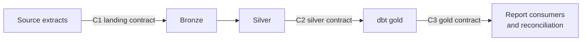

# Data Contracts

Status: framework and baseline entity contracts defined in Phase 00. Column-level types, allowed values, event metadata columns and the machine-readable versions under `data/contracts/` are finalised in Phase 01. Where this document and the Phase 01 machine-readable contract disagree, the machine-readable contract wins and this document is updated.

## 1. What a contract means here

A data contract is a written promise from a producer to its consumers about structure (columns, types, nullability), semantics (keys, allowed values, business rules) and delivery (format, frequency, incremental behaviour). Each contract has a version. A change that can break a consumer (removing or renaming a column, tightening a type, changing a key) is a major version change and needs a migration note; adding a nullable column is a minor change.

## 2. Contract boundaries

| Contract | Producer | Consumer | Enforced by |
|---|---|---|---|
| C1 Landing | Source system (the generator) | Lakeflow bronze and the legacy job | Phase 01 validator; bronze is tolerant, so violations surface in silver validation |
| C2 Silver | Lakeflow pipeline | dbt staging models | Lakeflow expectations and quarantine; dbt source tests |
| C3 Gold | dbt | Reporting and reconciliation | dbt schema tests and custom business tests |

Bronze has no contract beyond "every received row is stored with its metadata". That is deliberate: bronze must never reject data, otherwise evidence of a source problem is lost.

## 3. Global conventions (C1)

| Item | Convention | Note |
|---|---|---|
| Format | CSV, comma separated, header row, RFC 4180 quoting | |
| Encoding | UTF-8 without BOM | |
| Null | Empty field | The string `NULL` is not a null |
| Dates | `YYYY-MM-DD` | |
| Timestamps | ISO 8601 in UTC with `Z` suffix | Proposed; Phase 01 confirms |
| Business date | Derived from the UTC timestamp in `Asia/Kuala_Lumpur` (UTC+8, no daylight saving) | Daily marts use the local date |
| Money | MYR, two decimal places, written as plain decimal text | Typed as `DECIMAL(18,2)` in silver and gold; never floating point |
| Rounding | Half-up at two decimals | Matches Spark `round()`; Python generators must set `ROUND_HALF_UP` explicitly because the `decimal` module defaults to half-even |
| Identifiers | Stable strings, unique per entity, never reused | Format fixed in Phase 01 |
| Ordering metadata | `source_updated_at` on every mutable entity, plus a stable event or record identifier for tie-breaking | Phase 01 defines the exact columns |

## 4. Baseline entity contracts (C1 and C2)

Columns below are the baseline set from the Phase 01 brief. Phase 01 adds event and batch metadata columns and fixes types.

### customers
| Column | Required | Rule |
|---|---|---|
| customer_id | Yes | Primary key |
| name | Yes | Synthetic only |
| email | Yes | Synthetic only, valid format |
| region | Yes | Allowed list (Phase 01) |
| created_at | Yes | Valid timestamp |
| updated_at | Yes | Valid timestamp, not before `created_at` |

### products
| Column | Required | Rule |
|---|---|---|
| product_id | Yes | Primary key |
| category | Yes | Allowed list (Phase 01) |
| price | Yes | `DECIMAL(18,2)`, greater than zero |
| status | Yes | Allowed list (Phase 01) |

### orders
| Column | Required | Rule |
|---|---|---|
| order_id | Yes | Primary key |
| customer_id | Yes | References customers (see section 6) |
| order_date | Yes | Valid timestamp |
| status | Yes | Allowed list (Phase 01) |
| source_updated_at | Yes | Valid timestamp; sequence column for CDC |

### order_items
| Column | Required | Rule |
|---|---|---|
| order_item_id | Yes | Primary key |
| order_id | Yes | References orders |
| product_id | Yes | References products |
| quantity | Yes | Integer, greater than zero |
| unit_price | Yes | `DECIMAL(18,2)`, greater than or equal to zero |

### payments
| Column | Required | Rule |
|---|---|---|
| payment_id | Yes | Primary key |
| order_id | Yes | References orders |
| amount | Yes | `DECIMAL(18,2)`; negative only if Phase 01 models refunds explicitly |
| method | Yes | Allowed list (Phase 01) |
| status | Yes | Allowed list (Phase 01) |

## 5. Silver contract guarantees (C2)

For every silver entity table:

1. The primary key is unique and not null.
2. Every required column is not null and correctly typed.
3. Monetary columns are `DECIMAL(18,2)`; quantities are integers.
4. Each key holds the version with the greatest `source_updated_at` (ties broken deterministically) among all valid rows received so far.
5. Rows that violated a rule are in `<entity>_quarantine` with the names of the failed rules, original string values, source file and ingestion time.
6. Foreign keys are not guaranteed (section 6).

## 6. Quality rules and enforcement

| Anomaly (Phase 01 scenario) | Layer | Behaviour | Why |
|---|---|---|---|
| Exact duplicate or replayed record | Silver | Collapsed by keyed upsert; bronze keeps both copies | Bronze is evidence; silver is truth |
| Duplicate key with different content | Silver | Latest `source_updated_at` wins; tie-breaker decides equal timestamps | Matches source-of-truth semantics |
| Null required value | Silver | Quarantine | Row cannot be keyed or is incomplete |
| Malformed timestamp or number | Silver | `try_` parse returns null, then quarantine | Never fail the whole run for one row |
| Negative or otherwise invalid amount | Silver | Quarantine (unless an explicit refund type is modelled) | Business rule |
| Invalid reference (unknown customer or product) | Silver keeps, dbt tests, reconciliation reports | Flagged, not rejected | A parent may arrive in a later batch; rejecting would lose valid data |
| Order and payment totals disagree | Gold | dbt business test and reconciliation report | Cross-entity rule, not a row-level rule |
| Late arrival (older `source_updated_at`) | Silver | Ignored for that key if a newer version exists | Sequence ordering |
| Source correction (newer `source_updated_at`) | Silver | Replaces current version | Sequence ordering |
| New column in source file (schema evolution) | Bronze accepts; silver ignores until the contract adopts it | Explicit contract change | Prevents silent downstream changes |

## 7. Gold contract (C3)

Each mart declares its grain, unique key, not-null columns and business tests in dbt YAML (Phase 04). Baseline grains are listed in `architecture.md` section 7.

## 8. Change process

1. Update the machine-readable contract under `data/contracts/` and bump its version.
2. Update this document and the affected ADR if the change is architectural.
3. Update generator, validators, pipeline and dbt tests in the same change.
4. Record the change in the relevant phase HANDOFF.
