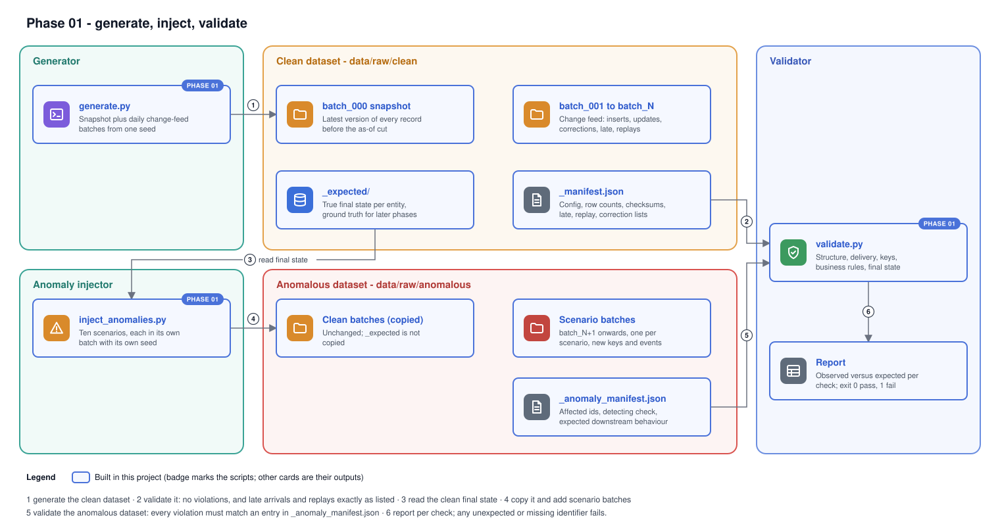
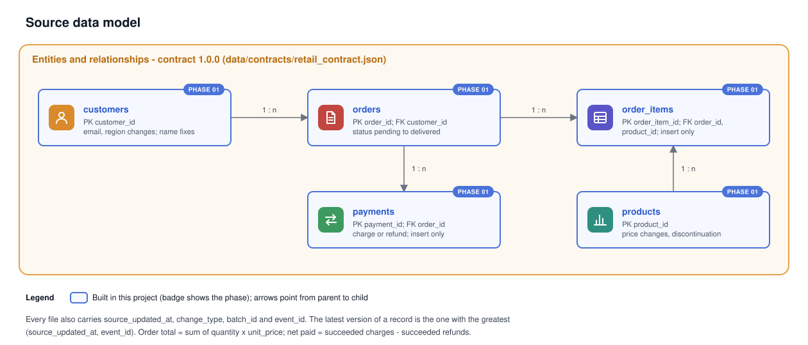

# Phase 01 Explanation: Synthetic Data Generation and Data Contracts

Status: authored, not executed. Nothing described here has been run yet. Behaviour statements describe what the code is written to do; they become facts only once the runbook has been run and the results recorded in `HANDOFF.md`.

## 1. Objectives

1. Produce realistic, fictional retail data for a Malaysian retailer that every later phase can consume: the legacy job (Phase 02), the Lakeflow pipeline (Phase 03), dbt (Phase 04) and reconciliation (Phase 06).
2. Make it deterministic: the same configuration and seed must give byte-identical files on any machine.
3. Simulate an initial snapshot followed by incremental batches with inserts, updates, corrections, late arrivals and replays.
4. Inject anomalies on demand, kept apart from the clean data, each listed in a machine-readable manifest.
5. Validate any dataset against the contract and its manifests, failing loudly on anything unexpected.
6. Turn the Phase 00 contract framework into a machine-readable contract that later phases can load.

## 2. What was built

| File | Purpose |
|---|---|
| `data/contracts/retail_contract.json` | The landing contract C1: columns, types, required flags, allowed values, patterns, ranges, keys, foreign keys, feed columns, business rules |
| `data/generators/common.py` | Shared helpers: contract access, deterministic randomness, money and time formatting, CSV and JSON I/O, safe output directory handling |
| `data/generators/generate.py` | Builds the clean dataset: snapshot, change-feed batches, ground-truth final state, manifest |
| `data/generators/inject_anomalies.py` | Copies a clean dataset and adds up to ten anomaly scenarios, each in its own batch |
| `data/generators/validate.py` | Checks a dataset against the contract and manifests, prints a report, exits non-zero on failure |
| `data/__init__.py`, `data/generators/__init__.py` | Empty; make `data.generators` an importable package |
| `tests/unit/test_data_generation.py` | 30 pytest tests on the tiny preset |
| `pyproject.toml` | pytest settings (`pythonpath`, `testpaths`) |
| `requirements-dev.txt` | `pytest` only |
| `docs/diagrams/data-model.svg`, `docs/diagrams/data-generation-flow.svg` | Diagrams for this phase |
| `docs/data_contracts.md` | Updated with the final columns, feed semantics and business rules |

Committed sample data (`data/samples/`) is produced by the maintainer with the runbook, not authored by hand.



## 3. Datasets and relationships



| Entity | Key | Changes over time | Relationship |
|---|---|---|---|
| customers | `customer_id` | Email or region change; a name correction | Parent of orders |
| products | `product_id` | Price change; discontinuation; a name correction | Parent of order items |
| orders | `order_id` | Status: pending, paid, shipped, delivered, or cancelled | Child of customers; parent of items and payments |
| order_items | `order_item_id` | Never; inserted with the order | Child of orders and products |
| payments | `payment_id` | Never; each record is inserted once with its final status | Child of orders |

Two derived quantities matter for every later phase:

- **Order total** = sum over the order's items of `quantity * unit_price`. `unit_price` is the product price when the order was placed, so later price changes do not alter old orders.
- **Net paid** = succeeded charges minus succeeded refunds. Failed payments carry an amount but move no money.

Every file also has four feed columns: `source_updated_at`, `change_type`, `batch_id` and `event_id`. They are explained in section 5.

## 4. Time model

Everything is measured from the **as-of date** (default 2026-01-01, midnight UTC):

| Period | Content |
|---|---|
| 730 days before the order history | Customers and products are created |
| `history_days` before as-of (90 for small and medium, 30 for tiny) | Snapshot orders are placed |
| Day k after as-of, k = 1..`batches` | Batch k: new customers, new orders, every order lifecycle step that falls on that day, customer and product changes, corrections |

No code reads the system clock, so a run today and a run next year produce the same files.

## 5. Generator design

### 5.1 Versions, not tables

The generator does not build tables and then mutate them. It records every change as a **version**: a timestamp, the entity, the key, the change type (`insert`, `update`, `correction`) and a full image of the row after the change. An order that is placed, paid, shipped and delivered produces four versions of the same `order_id`.

From that single history, three outputs are cut:

1. **Snapshot (`batch_000`)**: for each record, its latest version before the as-of cut, with `change_type = snapshot`. Exactly one row per key.
2. **Change-feed batches (`batch_001` onwards)**: every version whose timestamp falls on day k goes into batch k. A record can appear several times in one batch.
3. **Ground truth (`_expected/`)**: for each record, its latest version before the end of the last batch window. This is what a correct pipeline must reconstruct.

Because all three come from the same history, they cannot disagree. This is the main reason for the design: the hard question for later phases is "did you reconstruct the right final state?", and the generator answers it independently of any pipeline logic.

`event_id` is assigned after sorting all versions by time, so `EVT-00000001` is the earliest event and ids increase with time. Two versions of one record never share a timestamp (`History.add` moves a clashing version one second later), so clean data has no sequence ties.

### 5.2 Order lifecycles

Each order follows one of five paths, chosen with illustrative weights:

| Path | Weight | Steps |
|---|---|---|
| normal | 85 | Placed, possibly a failed attempt (10%), charged in full or in two parts (5%), paid, shipped 12-48 h later, delivered 1-5 days later, possibly a partial refund of one line 1-7 days after delivery (5%) |
| cancel_unpaid | 5 | Placed, cancelled within 48 h, no payment |
| cancel_paid | 3 | Placed, charged, paid, cancelled within 24 h, refunded in full at the same instant as the cancellation |
| pending | 5 | Placed, possibly a failed attempt, never paid |
| pending_partial | 2 | Placed, one partial charge, never completed |

Lifecycles extend past the as-of date, which is how batches receive status updates for orders placed before it. Steps after the last batch window are simply never delivered. The paths are built so the business rules hold at every possible cut-off point:

- An order becomes `paid` at the instant its final charge succeeds.
- A paid cancellation and its refund share a timestamp.
- A split payment leaves the order `pending` until the second charge.

### 5.3 Customers and products

- 5% of records are created with a lower-case name. In later batches, **corrections** restore the proper name (at least one per batch while any remain). This gives corrections a real meaning: they fix wrong data.
- Customers: 20% change before the snapshot. In each batch, 1% change email or region, and new customers are created.
- Products: 8% start discontinued. In each batch, 2% change price by -10% to +15%, and 0.5% are discontinued. Orders only use products that stay active throughout, so no order sells a discontinued product.

### 5.4 Late arrivals and replays

After cutting the batches:

- **Late arrivals**: about `late_rate` (default 1%) of batch events, at least one, move from their day's batch to a later batch. `batch_id` shows the batch they actually arrived in.
- **Replays**: about `replay_rate` (default 1%) of batch rows, at least one, are copied unchanged, `batch_id` included, into a later batch.

Both are listed in `_manifest.json`. They are valid source behaviour (out-of-order and at-least-once delivery), so they are part of clean data. A correct pipeline must ignore them. A naive one, for example "last file wins" or "sum every row", gets them wrong, and that difference is what Phase 06 reconciliation explains.

### 5.5 Outputs

```
<out>/
  batch_000/   customers.csv products.csv orders.csv order_items.csv payments.csv
  batch_001/   (same five files, possibly header-only)
  ...
  _expected/   five files: final state, business columns + source_updated_at + event_id
  _manifest.json
```

`_manifest.json` records:
- the full configuration
- for every file, its row count and SHA-256
- the late arrivals, replays and corrections
- the expected final row counts

It contains no generation timestamp, so it is reproducible too.

## 6. Determinism

| Risk | Mitigation |
|---|---|
| Random helpers changing between Python versions | Python only guarantees that `random()` returns the same sequence for the same seed. `Rng` builds `below`, `choice`, `weighted`, `sample` and `seconds` on top of `random()` alone |
| Current date | None of the generator's logic reads the clock; the as-of date is a parameter |
| Locale | Timestamps use a fixed format string; no locale-dependent formatting |
| Dictionary or set ordering | Every output is explicitly sorted; JSON is written with `sort_keys` |
| Floating point money | Money is `Decimal` throughout, formatted with two places, rounded half-up |
| Line endings | CSVs are written with `\n` regardless of platform |

The test `test_same_configuration_gives_identical_files` and runbook Step 5 check this directly.

## 7. Presets and counts

| Preset | customers | products | orders (snapshot) | per batch: new customers / new orders | history days |
|---|---|---|---|---|---|
| tiny | 40 | 15 | 60 | 3 / 8 | 30 |
| small | 500 | 50 | 5,000 | 10 / 100 | 90 |
| medium (default) | 5,000 | 500 | 50,000 | 50 / 1,000 | 90 |

Any count can be overridden: `--customers`, `--products`, `--orders`, `--batch-customers`, `--batch-orders`, `--history-days`, `--batches`.

- **Exact:**
  - snapshot rows for customers, products and orders equal the configured counts
  - final customers = customers + batches x batch_customers
  - final orders = orders + batches x batch_orders
  - final products = products
- **Approximate:**
  - order items average about 2 per order (1-4 lines, weighted 35/35/20/10), so medium gives roughly 100,000+
  - payments vary by lifecycle path (about one per order on average)
  - per-batch update, late, replay and correction counts depend on how many events fall in each window

The manifest records every actual count.

## 8. Anomaly injection

The injector never touches the clean dataset. It copies it (without `_expected/`) and adds one batch per selected scenario. Each scenario has a fixed batch number (`N + its position in the list`) and its own random stream (`seed * 1000 + position`). So a scenario's rows are identical whether it runs alone or with all the others; the test `test_scenario_output_does_not_depend_on_other_scenarios` checks this. Injected rows use event ids `EVT-Annn-nnnnn` (which sort after every clean id) and, for new records, keys containing `X`.

| Scenario | What is added (count k per entity, default 5) | Detecting check | Expected downstream behaviour |
|---|---|---|---|
| duplicate_key_conflict | Payment rows with an existing `payment_id` and the same `source_updated_at`, different `method` | sequence_conflict | Bronze keeps both rows; silver keeps the higher `event_id` |
| null_required | Copies with blank `customers.customer_id`, `orders.status`, `payments.order_id` | required | Quarantine; silver unchanged |
| invalid_reference | New order for unknown customer; new item for unknown product; new payment for unknown order | foreign_key | Kept in silver, flagged by relationship tests |
| negative_amount | Payment copies with a negative amount | range | Quarantine |
| payment_mismatch | Extra 5.00 charge on delivered orders | orders.paid_amount_matches | Kept in silver; gold test fails; reconciliation reports the order |
| malformed_timestamp | Orders with an unparseable `order_date` | type | Quarantine |
| malformed_type | Items with non-integer quantity; payments with malformed amounts | type | Quarantine |
| schema_evolution | Customer rows with an extra `loyalty_tier` column | header | Bronze captures it; silver ignores it |
| late_arrival | Older order version (shipped, one hour before the current delivered version) | late_arrival | Silver ignores it |
| replay | Exact copies of existing clean order rows | replay | Silver unchanged |

`_anomaly_manifest.json` holds, for every scenario and entity:
- the identifiers that must be detected
- the check that must detect them
- the count
- the expected behaviour and its effect on silver

Each scenario is designed to trigger exactly one check, so a failure points to one cause. For example, the conflicting payment changes only `method`, not `amount`, so it does not also break the payment-total rule.

## 9. Validator design

The validator replays the dataset in delivery order (batch by batch, file by file, row by row). It collects, for each check, the set of identifiers it observes. Those sets are compared with the sets the manifests say to expect.

| Group | Check | Identifier | Clean expectation |
|---|---|---|---|
| structural | integrity | file path | none: every file matches its manifest checksum |
| structural | header | file path | none |
| structural | required, type, domain, range | event id | none |
| delivery | replay | event id | exactly the manifest's replays |
| delivery | late_arrival | event id | exactly the manifest's late arrivals |
| delivery | event_conflict, duplicate_event, sequence_conflict | event id | none |
| relational | foreign_key | event id | none, checked on the final state |
| business | eight rules from the contract | `entity:key` | none, checked on the final state |
| state | expected_state | `entity:key` | none: reconstructed state equals `_expected/` (clean datasets only) |

Rules the validator follows:

- **Invalid rows are excluded from the final state.** This mirrors quarantine, so business and relational checks see what silver would see.
- **Replays come first.** A row whose `event_id` has been seen before is classified as a replay (identical content) or an event conflict (different content), and nothing else.
- **Late arrival is defined precisely.** A row is late if it is delivered in a batch after the batch its `source_updated_at` falls into. The generator uses the same definition, so the two cannot disagree.
- **Sequence ties are checked.** Two different events for one key with the same `source_updated_at` are a sequence conflict if their content differs, or a duplicate event if it is the same.
- **Unknown checks still fail.** A check name in a manifest that the validator does not know shows up as a failure, so a typo cannot silently pass.

Comparing sets of identifiers, rather than counts, means the validator catches the right number of the wrong rows.

The report has one line per check. Exit status: 0 pass, 1 mismatch, 2 usage error (for example a directory with no `_manifest.json`).

## 10. Important functions

| Function | Arguments | Returns | Fails when |
|---|---|---|---|
| `generate.Config.validate()` | none | None | Counts below their minimum, fewer than 4 products, more than 999 batches, rates outside 0-1: `ValueError` listing every problem |
| `generate.generate(cfg, contract)` | Config, loaded contract | dict of files, expected state and delivery lists | Invalid config; generator constants out of step with the contract; no product stays active |
| `generate.write_output(result, cfg, contract, out, force)` | result, config, contract, output path, overwrite flag | manifest dict | Output exists and is not empty without `force`; or with `force` but no `_manifest.json` (not ours, never deleted) |
| `generate.run(cfg, out, force)` | config, path, flag | manifest dict | As above |
| `inject_anomalies.inject(source, out, scenarios, count, seed, force)` | clean dataset, output path, scenario names, rows per scenario, seed, flag | anomaly manifest dict | Unknown scenario, none chosen, count below 1, source is not a clean dataset or already anomalous, output inside the source |
| `validate.validate(data_dir)` | dataset path | `Report` (`ok`, `mismatches()`, `summary()`) | No `_manifest.json`: `ValueError` |
| `common.Rng` | integer seed | deterministic helpers | `below(0)` is never called: every caller guarantees a non-empty population |
| `common.money(value)` | number or string | `Decimal` rounded half-up to cents | Unparseable input raises `decimal.InvalidOperation` |
| `common.prepare_out_dir(out, force)` | path, flag | None | See `write_output` |

## 11. How later phases use this

- **Phase 02 (legacy job)** reads the CSVs locally. The snapshot alone gives a like-for-like baseline. Reading every batch naively shows how replays, late arrivals and corrections break a simple overwrite job.
- **Phase 03 (Lakeflow)**:
  - Upload a dataset folder to `/Volumes/<catalog>/retail_landing/raw/<dataset>/`. One Auto Loader glob per entity (`batch_*/orders.csv`) covers every batch.
  - Bronze stores every column as a string.
  - Silver sequences by `(source_updated_at, event_id)`.
  - Silver expectations can be generated from `retail_contract.json` (required, type, domain, range), so the rules exist once.
  - `_expected/` is the target that silver must match.
- **Phase 04 (dbt)**: the business rules become dbt tests; `payment_mismatch` is the case the paid-amount test must catch.
- **Phase 06 (reconciliation)**: the manifests list every late arrival, replay and injected anomaly, so every legacy-versus-modern difference can be traced to a cause.
- **Phase 07 (benchmarks)**: presets give repeatable input sizes.

## 12. Design decisions, alternatives and trade-offs

### P1. Standard library only

- **Decision.** The brief allows Faker, NumPy and Pandas.
  - Faker's output for a given seed can change between Faker releases. That would break the byte-identical guarantee unless Faker were pinned forever.
  - NumPy and Pandas add install weight for data this size and nothing the generator needs: a few hundred thousand rows are built from plain dicts.
  - Small name lists replace Faker. Pandas is not needed for CSV.
- **Trade-off.** Names are less varied than Faker's, and plain loops are slower than vectorised code. If medium-preset generation turns out too slow on your machine, that is the first thing to revisit; the runbook asks you to record the time.

### P2. One generator instead of `generate.py` plus `generate_batches.py`

- **Decision.** The brief suggests two scripts. Batches depend on the full history (order lifecycles cross the as-of date), so splitting would mean saving and reloading generator state between scripts.
- **Trade-off.** One script, one command, at the cost of a single larger file.

### P3. Flat `batch_NNN` folders instead of `raw/initial` and `raw/incremental`

- **Decision.** One naming pattern lets Auto Loader read every batch of an entity with a single glob, and batch order is plain lexical order. `batch_000` is the initial snapshot.
- **Trade-off.** The folder name does not say "initial"; the manifest and contract do.

### P4. JSON contract, not YAML

- **Decision.** JSON needs no third-party parser, and every tool in the project (Python, Spark, dbt macros, if needed) can read it.
- **Trade-off.** JSON has no comments, so the descriptions live in `description` fields.

### P5. Late arrivals and replays in clean data

- **Decision.** The brief lists them as both incremental behaviour and anomalies. They are valid delivery behaviour under at-least-once, out-of-order delivery, so the clean feed contains them (listed in the manifest). The injector can add more as explicit scenarios.
- **Trade-off.** For an exact legacy-versus-modern match on fully clean input, use the snapshot (`batch_000`) or set `--late-rate 0 --replay-rate 0`.

### P6. Anomalies as new rows in separate batches, not edits of clean rows

- **Decision.**
  - Editing clean rows would destroy the original and change the ground truth.
  - Adding new rows keeps the clean history intact, makes each scenario removable by deleting one folder, and lets each scenario be tested alone.
- **Trade-off.** Anomalies always arrive after the clean batches. Interleaving them in time is a Phase 06 extension if needed.

### P7. No committed fixture folders

- **Decision.** The brief suggests `data/fixtures/{duplicates,invalid_records,schema_evolution}`. Tests generate the tiny preset into a temporary directory instead, so fixtures can never drift from the generator. The committed `data/samples/` (tiny clean plus tiny anomalous) gives reviewers something to read on GitHub.
- **Trade-off.** Tests depend on the generator working; a generator bug fails many tests at once.

### P8. Validation by identifier sets

- **Decision.** Comparing counts would pass if the validator flagged the wrong five rows. Comparing exact identifiers does not.
- **Trade-off.** Manifests are larger, because they list identifiers.

## 13. Limitations and unverified items

- No code in this phase has been run. Syntax errors, logic errors and test failures are possible until the runbook has been completed.
- Run time and memory for the medium preset are unknown; record them.
- The distributions are illustrative, not modelled on real retail data.
- Timestamps are whole seconds in UTC; sub-second ordering is not simulated.
- Deletes are not modelled; cancellation is a status.
- The same validator logic is used for both clean and anomalous data. If it had a bug that matched a generator bug, both could agree and be wrong. The independent `test_paid_orders_match_their_charges` and the Phase 03 comparison against `_expected/` reduce that risk; they do not remove it.
