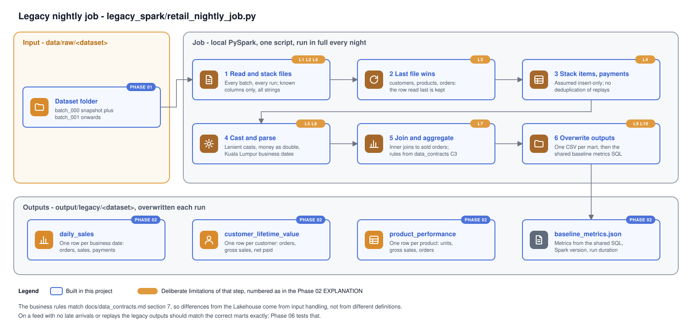

# Phase 02 Explanation: Legacy PySpark Job

Status: executed by the maintainer on 2026-10-31. The results are in `HANDOFF.md`, and section 5 compares them with the predictions. One open item, O1, is listed there.

## 1. Objectives

1. Build the job the migration replaces: a realistic nightly PySpark batch job that reads the CSV extracts, joins them by hand, aggregates three reporting outputs, overwrites them and logs with `print`.
2. Make its operational weaknesses deliberate, visible and documented, because they are what the Lakehouse is measured against.
3. Fix the business rules for the three outputs once (`docs/data_contracts.md` section 7), so the legacy job and the dbt marts compute the same thing and reconciliation compares input handling, not definitions.
4. Produce baseline reconciliation metrics with SQL that can be run unchanged against the gold marts in Phase 06.
5. Keep it runnable locally, and record its runtime only from real runs.

## 2. Files

| File | Purpose |
|---|---|
| `legacy_spark/retail_nightly_job.py` | The job. Limitations are marked `LIMITATION n` in the code |
| `legacy_spark/sql/baseline_metrics.sql` | 20 portable metrics over the three outputs |
| `legacy_spark/__init__.py` | Empty; makes `python -m legacy_spark.retail_nightly_job` work |
| `requirements-spark.txt` | `pyspark>=4.0,<5`, kept apart so the Phase 01 tools and CI stay dependency-free |
| `tests/unit/test_legacy_job.py` | 4 tests on the committed samples, against a plain-Python statement of the legacy rules; skipped without PySpark or Java |
| `docs/data_contracts.md` section 7 | Mart business rules (C3), shared with Phase 04 |
| `docs/diagrams/legacy-job.svg` | Diagram of the job |
| `.gitignore` | `.venv*/` so a separate Spark virtual environment is ignored too |

## 3. Walkthrough

**Session.** `local[*]` Spark, with:
- the session time zone pinned to `Asia/Kuala_Lumpur`
- ANSI mode off
- the time parser policy set to `CORRECTED`
- 4 shuffle partitions, which suits data this small
- the Spark UI disabled

Section 6 explains each setting.

**Step 1, read and stack (`read_all`).** For each entity, the job:
- lists `batch_*` folders in name order
- reads each CSV with a header and no schema inference, so every column is a string
- keeps only the hard-coded columns
- tags every row with its file number and its position in the file
- unions all files

It then counts the rows to log them, which is an extra full scan.

**Step 2, last file wins (`last_file_wins`).** For customers, products and orders, a window keeps one row per key: the highest file number, then the highest position in the file. That is the row read last. Within one file, rows are in event order, so several versions of an order on one day resolve to the latest. Across files, folder order decides, whatever `source_updated_at` says.

**Step 3, stack items and payments.** Order items and payments are treated as insert-only and kept exactly as read. Nothing removes a row that was delivered twice.

**Step 4, cast and parse.**
- Quantity is cast to integer; prices and amounts to double; line total = quantity times unit price.
- Payments are filtered to `succeeded`.
- `order_date` and `payment_at` are parsed with the pattern `yyyy-MM-dd'T'HH:mm:ssX` and turned into Kuala Lumpur dates.
- With ANSI off, anything that does not parse becomes null instead of failing the run.

**Step 5, join and aggregate.**
- Sold orders (`paid`, `shipped`, `delivered`) are inner-joined to items, giving `sold_lines`.
- Each output follows `docs/data_contracts.md` section 7:
  - `daily_sales` full-outer-joins four per-date aggregates and fills gaps with zero.
  - `customer_lifetime_value` left-joins customers to their sold-order, gross-sales and net-paid aggregates.
  - `product_performance` left-joins products to their sales.
- Money is rounded to two places only at this point.

**Step 6, write.** Each output is first materialised once with `localCheckpoint()`. Without that, the metrics query recomputes the whole plan and can disagree with the files (O1, section 5.1). Each output is then coalesced to one partition and written as CSV with a header, `mode("overwrite")`, into `output/legacy/<dataset>/<output>/part-*.csv`. Then `baseline_metrics.sql` runs over the three outputs as temporary views, and `baseline_metrics.json` records the metrics, the input path, the Spark version, the start time and the duration.

## 4. Deliberate limitations

| # | Limitation | Consequence | How the Lakehouse addresses it |
|---|---|---|---|
| L1 | Column lists hard-coded in the job | Contract changes need code edits; drift goes unnoticed | Expectations derived from `retail_contract.json` |
| L2 | Full reload of every batch on every run | Cost grows with history; the run gets slower forever | Auto Loader reads only new files |
| L3 | Last file wins for customers, products, orders | A late or replayed older version overwrites newer data | AUTO CDC sequenced by `(source_updated_at, event_id)` |
| L4 | Items and payments stacked without deduplication | Replayed rows are counted twice | Keyed upsert in silver; bronze keeps the evidence |
| L5 | Lenient casts, no validation | Malformed values become null and vanish from totals; negative amounts and null keys are accepted | Expectations with quarantine and counts |
| L6 | Known columns selected by name | A new column is silently ignored; a missing column crashes the job | Schema evolution handled in bronze; contract version change to adopt |
| L7 | Inner joins | Lines for missing orders vanish; lines for unknown products are in daily sales but not in product performance | Orphans kept and flagged by tests |
| L8 | Money as double | Possible cent-level drift on very large sums; rounding only at write time | `DECIMAL(18,2)` throughout |
| L9 | `print` logging and extra `count()` scans | No run id or structured log; wasted work | Pipeline event log; job run history |
| L10 | Overwrite in place, no history | A failed run can leave a mix of new and old outputs; no rollback | Delta transactions and time travel; dbt rebuilds |

Two choices are deliberately *not* legacy-realistic, because a baseline that changes between machines or crashes on every bad row would be useless:
- The time zone is pinned.
- Last-file-wins is deterministic. A typical real job would use `dropDuplicates`, which keeps an arbitrary row.

## 5. Expected behaviour on the generated data

Predicted by reading the code, not measured. Phase 06 measures it.

**Clean dataset:**
- Replayed items and payments are counted twice (L4).
- A late order, customer or product version overwrites a newer one (L3). It changes a sales figure only when it moves an order into or out of a sold status, for example a late `pending` row arriving after `paid`.
- Replays of orders, customers and products are identical copies, so last-file-wins leaves them unchanged.

**Ordered dataset** (`--late-rate 0 --replay-rate 0`): there is nothing for L3 or L4 to get wrong, so the legacy outputs should equal the correct marts exactly, apart from any L8 rounding. That is the exact-match test planned for Phase 06.

**Anomalous dataset**, scenario by scenario:

| Scenario | Expected legacy effect |
|---|---|
| duplicate_key_conflict | The conflicting payment copies are stacked, so those charges count twice |
| null_required | Orders whose latest row has a null status stop being sold; payments with a null order_id count in daily charges but not in lifetime net paid; customers with a null id collapse into one extra customer row |
| invalid_reference | Orders for unknown customers are pending, so not sold; payments for an unknown order count in daily charges only |
| negative_amount | The negative copy is stacked next to the original, so those payments net to zero |
| payment_mismatch | Extra 5.00 charges are counted, as they are in the correct marts |
| malformed_timestamp | Those orders' latest row has a null business date, so their sales move to a row with an empty date |
| malformed_type | Copies with bad numbers become null and drop out; the original rows still count |
| schema_evolution | The extra column is ignored; values are unchanged, so no effect |
| late_arrival | The older `shipped` version wins, but shipped is still sold, so no metric change |
| replay | Order replays are identical, so no effect |

### 5.1 Observed on the anomalous dataset

Measured on 2026-10-31. The injected rows were read from `data/raw/anomalous/batch_004` to `batch_013`.

**Payments reconcile exactly.** Daily charges rose by 1,833.05, made up of:

| Contribution | Amount |
|---|---|
| duplicate_key_conflict: conflicting copies counted twice | +1,610.86 |
| null_required: copies with a null order_id, still counted in daily charges | +2,714.00 |
| invalid_reference: payments for an unknown order | +50.00 |
| payment_mismatch: extra charges | +25.00 |
| negative_amount: negative copies cancel the originals | −2,566.81 |
| malformed_type: `12,50` and `abc` become null; `1.234` is a failed payment and excluded | 0.00 |
| **Total** | **+1,833.05** |

Lifetime net paid fell by 930.95, made up of 1,610.86 + 25.00 − 2,566.81. The null order_id and unknown-order payments are excluded there, as predicted. Refunds are unchanged, because no scenario injects refunds.

**Other metrics against the predictions:**

| Metric | Clean → anomalous | Explanation | Matches prediction |
|---|---|---|---|
| `customer_lifetime_value.rows` | 530 → 531 | The five null-id customers collapse into one row | Yes |
| `customer_lifetime_value.orders_sold` | 4,477 → 4,472 | The five null_required orders lose their sold status | Yes |
| `daily_sales.rows` | 94 → 99 | Two new dates (2026-01-06 invalid_reference, 2026-01-08 payment_mismatch) plus three null-date rows | Partly, see next row |
| `daily_sales.null_business_date_rows` | 0 → 3 | The prediction said one empty-date row. A full outer join never matches null to null, so the orders, sold-orders and sold-lines aggregates each produce their own null-date row. This is a real legacy defect: the totals stay complete, but a report filtering on date silently drops them | No: three rows, not one |
| `daily_sales.last_date` | 2026-01-04 → 2026-01-08 | Injected batches add later dates. Not predicted, but expected | Not covered |
| Gross sales, all three outputs | 2,646,985.28 → 2,644,655.33 | Equal in all three. The unknown-product items sit on `pending` orders, so they never reach sold lines. As a result, the L7 gap between daily and product gross is not exercised by this dataset | Consistent; not broken down by scenario |
| `items_sold`, `units_sold` | 16,242 → 16,221 | The null_required orders' lines, plus any malformed quantity that casts to a number | Consistent; not broken down by scenario |
| replay | none | The five replayed rows are the final versions of their orders (checked against `_expected/orders.csv`) | Yes |
| `daily_sales.orders_placed` | 5,300 → 5,310 in the written file | Ten new orders; five orders move to the null-date row | Yes in the file; the metrics JSON showed 5,308 (O1) |
| `daily_sales.orders_sold` | 4,477 → 4,472 in the written file | Equals `customer_lifetime_value.orders_sold` | Yes in the file; the metrics JSON showed 4,469 (O1) |

O1 was a defect in how the metrics were computed, not in the outputs. The metrics query recomputed the lazily evaluated plan and returned different order counts from the written files. The job now materialises each output once, so the files and the metrics come from the same rows. Details and evidence are in `HANDOFF.md`.

## 6. Configuration decisions

| Setting | Why |
|---|---|
| `spark.sql.session.timeZone = Asia/Kuala_Lumpur` | Business dates must not depend on the laptop's time zone (ADR 0006) |
| `spark.sql.ansi.enabled = false` | Spark 4 turns ANSI on by default, which makes bad casts fail the query. The job models a pre-ANSI job whose bad values become null (L5) |
| `spark.sql.legacy.timeParserPolicy = CORRECTED` | Without it, strings that the old date parser would accept but the new one rejects (such as month 13) can raise an upgrade error instead of becoming null |
| `spark.sql.shuffle.partitions = 4` | The default of 200 creates hundreds of tiny tasks for data this small |
| `spark.ui.enabled = false` | Avoids port conflicts and noise when tests start sessions repeatedly |
| `coalesce(1)` before writing | One readable file per output; acceptable at this size, a bottleneck at scale |

## 7. Baseline reconciliation queries

`legacy_spark/sql/baseline_metrics.sql` returns one row per metric, each value cast to `DECIMAL(38, 2)`:
- row counts per output
- null-date rows
- first and last business date
- sums of every measure
- customers and products with sales

It uses only `COUNT`, `COUNT_IF`, `SUM`, `MIN`, `MAX`, `DATE_FORMAT` and `CAST`, which are available in both Spark SQL and Databricks SQL. In Phase 06 the same text runs over views named `daily_sales`, `customer_lifetime_value` and `product_performance` that point at the gold marts.

One invariant is built in: on orphan-free data with valid dates, `daily_sales.gross_sales`, `customer_lifetime_value.lifetime_gross_sales` and `product_performance.gross_sales` are equal. A difference between them is itself a finding, for example items for unknown products (L7).

## 8. Design decisions and alternatives

| Decision | Alternatives considered | Why |
|---|---|---|
| Last file wins, deterministic | `dropDuplicates` (most realistic, but non-deterministic); latest by `source_updated_at` (correct, so not legacy) | A reproducible baseline that is still wrong in realistic ways |
| CSV outputs | Parquet (typed, faster) | Typical of the legacy job; readable by hand; Phase 06 reads them either way |
| Stack items and payments, dedupe only master data | Dedupe everything by key (no visible replay problem); dedupe nothing (orders double-count too) | Matches the common legacy assumption that line and payment feeds are insert-only |
| `argparse` for input and output paths | Hard-coded paths | The job must run on several datasets (samples, small, medium, anomalous). Column lists stay hard-coded (L1) |
| `pip install pyspark`, run with `python -m` | A Spark distribution and `spark-submit` | One less install; same engine |
| Separate `requirements-spark.txt` | One requirements file | Phase 01 tools and CI stay dependency-free and fast; Spark tests skip cleanly without PySpark |
| Test against a plain-Python reference | Golden output files | Golden files would need running Spark to create them; the reference states the legacy rules directly and catches a job that drifts from them |

## 9. Limitations and unverified items

- Verified on the maintainer's Mac: PySpark 4.3.0 on Python 3.15.1 with OpenJDK 17.0.21.
- Runtime is recorded only from the maintainer's runs. Local Spark start-up dominates at these sizes: small and medium both take about 10 s.
- The anomalous-dataset predictions in section 5 have been checked against a real run (section 5.1). O1 is traced to the metrics path. The fix is written but has not been run. The Spark mechanism behind the different recomputation has not been identified.
