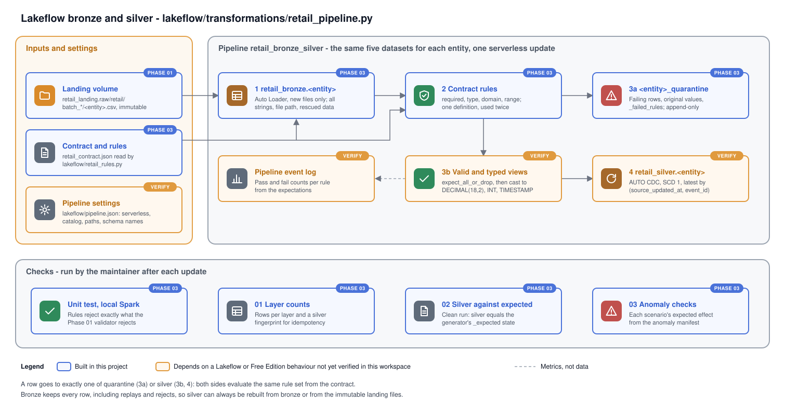

# Phase 03 Explanation: Lakeflow Bronze and Silver

Status: authored, not run. Nothing in this phase has been deployed or executed. The local unit tests and every workspace step are run by the maintainer (`MANUAL_RUNBOOK.md`); results go into `HANDOFF.md`.

## 1. Objectives

1. Ingest the landing CSVs into bronze incrementally, keeping every row exactly as received.
2. Validate every row against the landing contract and keep each rejected row, with its reasons, in a quarantine table.
3. Build silver as the current state of each record: latest valid version per key, by `(source_updated_at, event_id)`. Late arrivals and replays must have no effect.
4. Derive all rules from `data/contracts/retail_contract.json`, so the pipeline, the generator and the validator share one definition.
5. Make every claim checkable:
   - Silver must equal the generator's `_expected/` state on the clean dataset.
   - Each anomaly scenario must have its documented effect.
   - Reruns and replays must change nothing.

Lakeflow owns `retail_bronze` and `retail_silver` and nothing else (ADR 0001). Gold is Phase 04.

## 2. Files

| File | Purpose |
|---|---|
| `lakeflow/transformations/retail_pipeline.py` | The pipeline source: five datasets per entity |
| `lakeflow/retail_rules.py` | Builds bronze schemas, validation rules and silver projections from the contract; plain Python, no Spark import |
| `lakeflow/pipeline.json` | Pipeline settings for `databricks pipelines create`: serverless, catalog, default schema, source glob, configuration |
| `lakeflow/validation/01_layer_counts.sql` | Rows per layer and a content fingerprint per silver table |
| `lakeflow/validation/02_silver_vs_expected.sql` | Silver against `_expected/`, clean dataset |
| `lakeflow/validation/03_anomaly_checks.sql` | Each anomaly scenario's expected effect, as observed/expected rows |
| `tests/unit/test_lakeflow_rules.py` | Local Spark test: the rules reject exactly what the Phase 01 validator rejects |
| `docs/diagrams/lakeflow-pipeline.svg` | Diagram of the pipeline and its checks |

## 3. Data flow

The pipeline file loops over the five entities of the contract and defines, for each, the datasets below. With five entities that is 25 datasets in one pipeline graph: 15 tables and 10 views.

### 3.1 Bronze: `retail_bronze.<entity>` (streaming table)

Auto Loader (`cloudFiles`) reads `<landing>/batch_*/<entity>.csv`:
- `header` is true and the schema is given explicitly: every contracted column as `STRING`, in contract order.
- Columns a file adds beyond the contract go into `_rescued_data` instead of being dropped.
- Each row gets lineage columns:
  - `_source_file`, from `_metadata.file_path`
  - `_file_modified_at`
  - `_ingested_at`, the time of the update that read it

Auto Loader records processed files in the pipeline's checkpoint, so each update reads only files it has not seen. Bronze is append-only and never rejects a row. Replays, invalid rows and late versions all land here, which keeps bronze the evidence for everything downstream.

### 3.2 Rules: `lakeflow/retail_rules.py`

For every column, the business columns followed by the four feed columns, the contract yields up to four rules. Each rule is named `<entity>.<column>.<check>`:

| Check | Applies when | Passes when |
|---|---|---|
| `required` | The column is required | The value is not null (Auto Loader reads an empty field as null) |
| `type` | The column is a timestamp, decimal or integer | The value is null, or well formed: `YYYY-MM-DDTHH:MM:SSZ` that is also a real date and time; `-?digits.dd`; `-?digits` |
| `domain` | The contract lists `allowed` values or a `pattern` | The value is absent or malformed (judged by the other rules), or it is in the list or matches the pattern |
| `range` | The contract gives `min` or `min_exclusive` | The value is absent or malformed, or its cast value meets the bound |

This is the same logic as `row_problems` in the Phase 01 validator, including its rule names. A bad column produces exactly one reason, so a quarantined row's reasons line up with the check names in `_anomaly_manifest.json`.

Every rule is wrapped in `coalesce(<predicate>, false)`. A SQL predicate can evaluate to null. Without the wrapper, a null would make a row neither pass the silver filter nor match the quarantine filter, and the row would vanish. With it, every row is either valid or quarantined.

### 3.3 Quarantine: `retail_silver.<entity>_quarantine` (streaming table)

The quarantine table reads bronze as a stream and adds `_failed_rules`, an array of the names of the rules the row fails. It keeps the rows where that array is not empty. Rows keep their original string values, `_source_file`, `_ingested_at` and `_rescued_data`. The table is append-only, so each update adds only the newly ingested bad rows.

### 3.4 Silver path: two views, then AUTO CDC

- `<entity>_valid` (temporary view): reads bronze as a stream with `@dp.expect_all_or_drop(rules)`. Invalid rows are dropped here, and the pipeline event log records pass and fail counts for each rule.
- `<entity>_typed` (temporary view): casts the valid rows to their contract types (`DECIMAL(18,2)`, `INT`, `TIMESTAMP`) and keeps `_source_file` and `_ingested_at`.
- `retail_silver.<entity>` (streaming table): `dp.create_auto_cdc_flow` with
  - `keys=[<primary key>]`
  - `sequence_by=struct(source_updated_at, event_id)`
  - SCD type 1

The quarantine table and the valid view use the same rule dictionary: one keeps the rows where any rule fails, the other drops exactly those rows. The rules cannot drift apart because they are defined once (architecture section 6).

### 3.5 How each delivery behaviour is handled

| Behaviour | Bronze | Silver |
|---|---|---|
| Snapshot then change feed | Every row appended | Latest version per key |
| Several versions of a record in one batch | All appended | Highest `(source_updated_at, event_id)` wins |
| Late arrival: older version, later file | Appended | Ignored, because its sequence is lower than the current version's |
| Replay: same `event_id`, identical row | Appended again | No change: same sequence, same content |
| Correction: newer version | Appended | Replaces the current version |
| Same `source_updated_at`, different content (duplicate_key_conflict) | Both appended | Higher `event_id` wins, as the manifest expects |
| Invalid update to an existing record | Appended | Quarantined. Silver keeps the previous valid version |
| Orphan (unknown customer, product or order) | Appended | Kept; flagged by dbt tests in Phase 04 |
| Extra column in a file | Values in `_rescued_data` | Not selected |

## 4. Verification of the Lakeflow and Auto Loader APIs

Each item was checked on 2026-10-31 against the Databricks documentation pages listed at the end of this section. Anything not confirmed there is marked for verification in the workspace, which the runbook steps exercise.

| # | Assumption in the code | Documentation says | Status |
|---|---|---|---|
| V1 | `from pyspark import pipelines as dp` | This is the module to import. `import dlt` still works but Databricks recommends `pipelines` | Confirmed in docs |
| V2 | `dp.create_auto_cdc_flow(target, source, keys, sequence_by, stored_as_scd_type)` | Signature confirmed; `stored_as_scd_type` defaults to `"1"`. A `struct()` in `sequence_by` orders by its first field, then the next on ties | Confirmed in docs |
| V3 | Behaviour on exactly equal sequence values | Not stated | Not needed except for replays, which are identical copies. Runbook Step 9 tests it |
| V4 | `dp.create_streaming_table(name=..., comment=...)` | Signature confirmed | Confirmed in docs |
| V5 | `@dp.table` on a streaming read creates a streaming table | Stated | Confirmed in docs |
| V6 | Two-part names (`retail_bronze.customers`) let one pipeline publish to two schemas | Default publishing mode publishes to several catalogs and schemas; partially qualified names resolve against the pipeline's default catalog and schema. New pipelines use this mode | Docs support it; workspace test is FE7 (Step 6) |
| V7 | `@dp.expect_all_or_drop(rules)` | Used in the expectation patterns page | Confirmed in docs |
| V8 | Expectations on a `@dp.temporary_view` | Not shown on the pages read | Verify (Step 6). Fallback in section 7 |
| V9 | `@dp.temporary_view(name=...)` | Listed in the API reference index. The quarantine example on the expectation page uses `@dp.view`, possibly an older name | Verify (Step 6) |
| V10 | Auto Loader with an explicit schema: columns as given, schema evolution mode `none`, extra columns kept in `rescuedDataColumn` | `none` is the default with a provided schema; data is not rescued unless `rescuedDataColumn` is set. The pages read do not say explicitly that extra CSV columns land there | Verify (Step 10, schema_evolution check) |
| V11 | CSV columns are matched to the header by name | Implied ("reads each file according to its header"), not stated | Verify (Step 10) |
| V12 | `cloudFiles.allowOverwrites` defaults to false; `includeExistingFiles` to true | Stated | Confirmed in docs |
| V13 | No `cloudFiles.schemaLocation` needed in a pipeline | "Databricks manages schema location and other checkpoint information automatically" | Confirmed in docs |
| V14 | `_metadata.file_path` and `_metadata.file_modification_time` are available on Auto Loader reads | Not checked this session | Verify (Step 6; the update fails at analysis if not) |
| V15 | Pipeline JSON: `catalog`, `schema`, `serverless`, `libraries` with `glob`, `configuration` | `schema` is preferred over the legacy `target`. Serverless needs the Advanced edition, which is the default. A `glob` entry cannot be combined with `file` or `notebook` entries | Docs support it; verify on create (Step 5) |
| V16 | Pipeline code can append a workspace folder to `sys.path` and import a module from it | Documented for modules outside the pipeline root | Confirmed in docs; verify (Step 6) |
| V17 | Pipeline code can `open()` a workspace file | Not checked this session | Verify (Step 6) |
| V18 | `try_cast`, `RLIKE`, `array_compact`, `IF` | Standard Spark SQL; the local test runs them on Spark 4.3.0 | Confirmed locally only after the maintainer runs the test |

Documentation used:
- [Python language reference](https://docs.databricks.com/aws/en/ldp/developer/python-ref)
- [create_auto_cdc_flow](https://docs.databricks.com/aws/en/ldp/developer/ldp-python-ref-apply-changes)
- [create_streaming_table](https://docs.databricks.com/aws/en/ldp/developer/ldp-python-ref-streaming-table)
- [table](https://docs.databricks.com/aws/en/ldp/developer/ldp-python-ref-table)
- [Expectation patterns](https://docs.databricks.com/aws/en/ldp/expectation-patterns)
- [Auto Loader options](https://docs.databricks.com/aws/en/ingestion/cloud-object-storage/auto-loader/options)
- [Auto Loader schema inference and evolution](https://docs.databricks.com/aws/en/ingestion/cloud-object-storage/auto-loader/schema)
- [Enable the default publishing mode](https://docs.databricks.com/aws/en/ldp/migrate-to-dpm)
- [Pipeline properties reference](https://docs.databricks.com/aws/en/ldp/properties)
- [Import Python modules from Git folders or workspace files](https://docs.databricks.com/aws/en/ldp/import-workspace-files)

The product is called Lakeflow Spark Declarative Pipelines in current documentation, formerly Delta Live Tables. Its documentation path is `/ldp/`.

## 5. Design decisions

| # | Decision | Alternatives | Why |
|---|---|---|---|
| D1 | Bronze schema fixed by the contract, all strings, extra columns rescued | (a) Let Auto Loader infer, which gives strings for CSV by default. (b) Typed bronze | (a) Inference defaults to `addNewColumns`, which stops the stream with `UnknownFieldException` when `loyalty_tier` appears; the update fails and must be restarted. (b) A typed bronze turns `abc` into null before the evidence is stored. Fixed strings never fail and lose nothing |
| D2 | Rules generated from the contract, mirroring the Phase 01 validator, with names `<entity>.<column>.<check>` | Hand-written rule dictionary; SQL file of constraints | One source of truth. The unit test can prove that pipeline and validator agree row by row. Rule names map directly to the anomaly manifest |
| D3 | Format checked by regular expression, values by `try_cast` | `try_cast` alone | `try_cast('1.234' AS DECIMAL(18,2))` returns 1.23 instead of failing, and casting `1.5` to an integer depends on ANSI settings. The regular expressions match the validator exactly and do not depend on the engine version |
| D4 | Every rule wrapped in `coalesce(..., false)` | Bare predicates | Guarantees each row is either valid or quarantined; a null can never make a row disappear |
| D5 | Separate quarantine streaming table from bronze, plus `expect_all_or_drop` on the silver path | (a) Documented flag-and-split pattern: one private table with an `is_quarantined` column, two views. (b) `expect_or_drop` with no quarantine table | (a) stores every row a second time and leaves no table of rejects. (b) only counts rejected rows. This design keeps the rejects inspectable, the event-log counts, and one rule definition. The cost is that rules are evaluated twice per row, which is negligible at this size |
| D6 | AUTO CDC, SCD 1, sequenced by `struct(source_updated_at, event_id)` | (a) `MERGE` in `foreachBatch`. (b) Materialized view taking the latest row per key with a window | (a) requires hand-written ordering, late-arrival and tie handling (ADR 0004). (b) is simple and correct, but reads all of bronze on each update, which is the full-reload pattern being replaced. `event_id` as second field gives a total order, so ties cannot be non-deterministic |
| D7 | Two-part table names; catalog only in `pipeline.json` | Three-part names in code | The catalog stays configurable in one place (`RETAIL_CATALOG` in ADR 0002), and the code does not hard-code `workspace` |
| D8 | Code uploaded to `/Workspace/Shared/spark-to-databricks-migration` with the CLI | (a) A Git folder cloned from GitHub. (b) A bundle (Phase 05) | The path needs no user name, so `pipeline.json` holds no personal data. The CLI uploads what is on disk, so a run does not depend on what has been pushed. A Git folder or bundle can replace this in Phase 05 |
| D9 | Contract loaded from a workspace file at graph definition | Copy the contract into Python constants | Copying it would bring back limitation L1 (hard-coded columns). The pipeline fails fast at start if the file is missing |
| D10 | Triggered (`continuous: false`), `development: true` | Continuous mode; production mode | Batches arrive by hand, so a continuous pipeline would idle. Development mode suits iteration; Phase 05 decides the production settings |
| D11 | Orphans kept in silver | Reject them as quarantine | A parent can arrive in a later batch; rejecting would lose valid data (data contract section 6). dbt tests flag orphans in Phase 04 |
| D12 | Deletes not modelled (`apply_as_deletes` unset) | Soft or hard deletes | The source models cancellations as status changes and sends no deletes (Phase 01) |

## 6. Incremental behaviour, reruns and recovery

- **No new files:** Auto Loader finds nothing new. No rows reach any streaming table, and silver is unchanged (AC5). Runbook Step 8 checks counts and fingerprints.
- **Replayed batch:** a new folder holding a copy of an earlier batch. Bronze grows by its row count; silver does not change (AC5). Step 9.
- **Overwritten file:** with `allowOverwrites` false, a file replaced under the same path is not read again. Landing files are therefore immutable. A correction must arrive as a new file.
- **Full refresh:**
  - All tables are rebuilt from every file in the volume.
  - Silver must match the incremental result, which Step 11 compares by fingerprint.
  - `_ingested_at` changes, so it is excluded from the fingerprint.
- **Fixing quarantined data:** the source sends a corrected row with a newer `source_updated_at` in a new batch. The quarantine table keeps the original reject as history. This design does not reprocess rows from quarantine.
- **Silver logic bug:** fix the code, upload it, run a full refresh. Bronze is rebuilt from the landing files, so nothing depends on bronze surviving.

## 7. Fallbacks

| If this fails | Symptom | Fallback |
|---|---|---|
| FE7: two schemas from one pipeline | Error naming `retail_bronze` at create or first update | Set `retail.bronze_schema` to `retail_silver` and prefix bronze table names with `bronze_` (one-line change in `define_entity`). Record it in `platform_assumptions.md` |
| V8: expectations on a temporary view | Error at graph analysis naming `expect_all_or_drop` | Replace the decorator with `.filter(F.size(F.expr(rr.failed_rules_sql(rules))) == 0)` in `valid_view`. Results are the same, but the per-rule counts in the event log are lost; the quarantine table still has them |
| V9: `dp.temporary_view` not found | `AttributeError` | Use `@dp.view`, the name used in the expectation patterns page |
| V16 or V17: workspace import or `open()` | `ModuleNotFoundError: retail_rules` or `FileNotFoundError` | Check the uploaded paths (Step 3). Otherwise upload `retail_rules.py` into `lakeflow/transformations/`, which is the pipeline source folder, and adjust `retail.code_root` |
| V10: extra columns not rescued | The schema_evolution check reports 0 | Bronze still holds all contracted values. Record the finding; the column would be adopted through a contract change either way |

## 8. Limitations

- The pipeline has not run. Every result is a prediction until `HANDOFF.md` records it.
- Cross-row rules (an order's charges equal its total, refunds within charges) are not silver rules. They belong to gold (Phase 04).
- The unit test proves the rules match the validator under local Spark 4.3.0. It does not prove that the serverless runtime evaluates them the same way. Step 7 does that on real data.
- Lakeflow cannot run locally with AUTO CDC and expectations, which the documentation describes as Databricks-only, so the pipeline graph itself is only tested in the workspace.
- Bronze grows with every replay. That is acceptable at demo scale; production would add retention.
- Development mode and a single pipeline for all entities fit a demo. Production would weigh separate pipelines per domain and production mode with retries.
