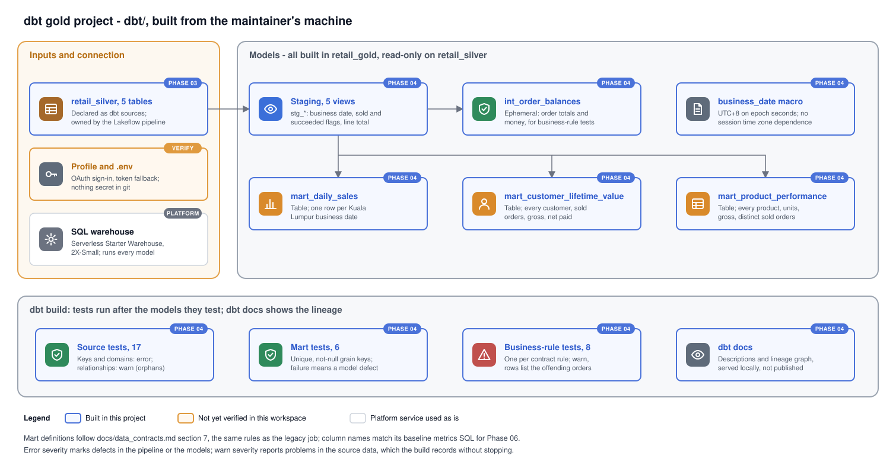

# Phase 04 Explanation: dbt Gold

Status: authored, not run. dbt has not been installed, connected or run. Results go into `HANDOFF.md` when the maintainer has run `MANUAL_RUNBOOK.md`.

## 1. Objectives

1. Build the three reporting marts from silver with dbt Core, using exactly the definitions in `docs/data_contracts.md` section 7. These are the same definitions the legacy job uses.
2. Test the silver contract at the boundary, test the marts' grain, and turn each of the contract's eight business rules into a dbt test.
3. Keep ownership clean (ADR 0001): dbt reads `retail_silver` and builds only in `retail_gold`.
4. Connect from the maintainer's machine to the SQL warehouse without putting a credential in git.
5. Publish descriptions and lineage with `dbt docs`.

## 2. Files

| File | Purpose |
|---|---|
| `dbt/dbt_project.yml` | Project config: staging as views, marts as tables, dbt 1.10.5 or later |
| `dbt/profiles.example.yml` | Connection template; every value comes from the environment. Copied to the git-ignored `dbt/profiles.yml` |
| `dbt/macros/business_date.sql` | Kuala Lumpur business date of a UTC timestamp |
| `dbt/models/staging/_sources.yml` | Silver tables as sources, with the contract tests |
| `dbt/models/staging/stg_*.sql`, `_staging.yml` | One view per silver table with the shared derived columns |
| `dbt/models/intermediate/int_order_balances.sql` | Ephemeral: per-order total and money, used only by the business-rule tests |
| `dbt/models/marts/mart_*.sql`, `_marts.yml` | The three marts and their tests and documentation |
| `dbt/tests/business/*.sql` | Eight singular tests, one per contract business rule |
| `dbt/checks/04_gold_checks.sql` | SQL editor checks: mart totals recomputed from silver |
| `requirements-dbt.txt` | dbt Core and dbt-databricks, in their own environment |
| `tests/unit/test_dbt_project.py` | Static checks: every contract business rule has a dbt test; no model sets a custom schema |
| `docs/diagrams/dbt-gold.svg` | Diagram of the project |

## 3. Data flow



```
retail_silver.<entity>  (source, owned by Lakeflow)
  -> retail_gold.stg_<entity>          view
  -> retail_gold.mart_daily_sales      table
     retail_gold.mart_customer_lifetime_value
     retail_gold.mart_product_performance
  int_order_balances (ephemeral, no object) -> business-rule tests
```

### 3.1 Sources

`_sources.yml` declares the five silver tables:
- catalog from `RETAIL_CATALOG`, default `workspace`
- schema `retail_silver`

dbt never writes to sources. Quarantine tables are not declared. They are operational data of the pipeline, not inputs to gold.

### 3.2 Staging views

Each `stg_<entity>` selects the business columns from silver one to one. It drops the feed and lineage columns, and adds only what several marts share:
- `stg_orders`: `order_business_date`, and `is_sold` (paid, shipped or delivered)
- `stg_order_items`: `line_total = quantity * unit_price`, cast to `DECIMAL(18,2)`
- `stg_payments`: `payment_business_date`, and `is_succeeded`

The rules are defined once here, so the marts and the tests cannot disagree about what "sold" or "business date" means.

### 3.3 Business date

`business_date(ts)` is:

```sql
date_from_unix_date(CAST((unix_seconds(ts) + 28800) div 86400 AS INT))
```

That is the epoch second of the instant plus eight hours, as whole days since 1970-01-01.

Malaysia is UTC+8 with no daylight saving (ADR 0006), so a fixed offset is exact. The obvious alternatives depend on the SQL warehouse's session time zone, which dbt does not set:
- `to_date(from_utc_timestamp(ts, 'Asia/Kuala_Lumpur'))` gives the Kuala Lumpur date only when the session time zone is UTC.
- `to_date(ts)` gives the date in whatever the session time zone happens to be.

The arithmetic depends on nothing but the instant. The trade-off: if the business ever moved to a zone with daylight saving, this macro would have to change. Its comment says so.

### 3.4 Marts

All three follow `docs/data_contracts.md` section 7. The column names are the ones `legacy_spark/sql/baseline_metrics.sql` reads, so Phase 06 can run that file unchanged against gold.

**`mart_daily_sales`** has one row per business date with any order or any succeeded payment.
- Four aggregates are computed separately:
  - orders by order date: placed, and sold
  - sold lines by order date: items, and gross
  - succeeded payments by payment date: charges, and refunds
- The set of dates is the union of order dates and payment dates. Each aggregate is left-joined onto that set, with zero for missing values.
- Money is cast to `DECIMAL(18,2)` once, at the end.

Compared with the legacy job:
- Dates are never null, because silver only holds valid timestamps. So there are none of the separate null-date rows the legacy job's full outer joins produced.
- Charges for payments whose order is missing from silver still count on their payment date. The contract attributes money by payment date, and the legacy job does the same.

**`mart_customer_lifetime_value`** has one row per silver customer, including customers with no sold orders (zeros and null dates).
- First and last order date, and orders sold, come from the customer's sold orders.
- Gross sales are the line totals of those orders.
- Net paid is succeeded charges minus refunds over all the customer's orders, whatever their status.
- Orders for a customer missing from silver are attributed to no one, as in the legacy job. The relationship test reports them.

**`mart_product_performance`** has one row per silver product: units, gross and distinct sold orders. Products never sold get zeros.

### 3.5 Tests and severities

The severity rule is applied everywhere:

| Severity | Meaning | Tests |
|---|---|---|
| error | A defect in the pipeline or the models: the build must stop | Unique and not-null keys and accepted values on silver (C2 guarantees); unique and not-null mart keys (grain) |
| warn | A real problem in the source data that silver keeps on purpose. Report it, don't stop | Relationships (orphans, data contract section 6); the eight business rules |

A business-rule failure on the anomalous dataset is the detection working: payment_mismatch makes five orders overpaid by 5.00. Failing the build on it would block gold every time the source sends bad data. Warnings make dbt print the count, and the test SQL lists the offending orders.

The business-rule tests mirror the Phase 01 validator's `_business_checks`:
- They use the same rule names, with dots replaced by underscores.
- Order-level rules skip orders without items, as the validator does.
- `customer_before_order` skips orders whose customer is missing.

`int_order_balances` is ephemeral. dbt inlines it into the tests, so it creates no object.

### 3.6 Expected results on the current silver

Silver currently holds the anomalous state (Phase 03, Step 11). Predicted from the anomaly manifest, not measured:

| Test | Expected |
|---|---|
| All error-severity tests | Pass |
| `relationships` orders.customer_id | Warn, 5 rows (`CUST-X99999`) |
| `relationships` order_items.product_id | Warn, 5 rows (`PROD-X9999`) |
| `relationships` payments.order_id | Warn, 5 rows (`ORD-X9999999`) |
| `relationships` order_items.order_id | Pass |
| `orders_paid_amount_matches` | Warn, 5 rows: ORD-0000570, ORD-0000753, ORD-0001065, ORD-0003988, ORD-0004038 |
| The other seven business tests | Pass |

`dbt/checks/04_gold_checks.sql` recomputes the mart totals from silver. Every row should be `ok`, including:
- **Lifetime net paid:** 50.00 below daily net payments. That is the five 10.00 charges for the unknown order `ORD-X9999999`.
- **Gross sales:** the same in all three marts. The unknown-product items sit on pending orders, so they are never sold.

## 4. Materialisations

| Layer | Choice | Alternatives | Why |
|---|---|---|---|
| Staging | View | Ephemeral; table | A view costs nothing to build, always reflects silver, and is visible in Unity Catalog lineage. Ephemeral would hide the shared logic from anyone querying gold |
| Intermediate | Ephemeral | View | Used only by tests; no reason to publish it |
| Marts | Table (Delta, full rebuild) | Incremental; view | A rebuild is idempotent by construction (architecture section 5) and cheap at these sizes. Incremental models add merge keys and late-data logic that the data does not need. Views would recompute on every report query. Each rebuild is a new Delta version, so time travel gives a previous mart for recovery |

## 5. Connection and credentials

- **Install dbt in its own environment, `.venv-dbt`, on Python 3.12.** I do not know whether dbt-core and its dependencies support Python 3.15 yet; a dependency without a 3.15 wheel would fail to build. A separate environment also keeps dbt's dependencies away from PySpark. `.venv*/` is already git-ignored.
- **`dbt/profiles.yml` is git-ignored.** The committed `profiles.example.yml` reads every value with `env_var()`:
  - `DATABRICKS_HOST`, with the `https://` removed in the profile
  - `DATABRICKS_HTTP_PATH`
  - `RETAIL_CATALOG`
  - `DATABRICKS_TOKEN`, only for the token target

  The values come from the local `.env`, loaded into the shell with `set -a; source ../.env; set +a`.
- **Two targets:**
  - `oauth` (default) uses OAuth user-to-machine sign-in. The Databricks documentation recommends it, and it stores no secret. dbt opens a browser to sign in, and the dbt documentation says it prompts again for each new dbt session.
  - `token` is the fallback, using a personal access token kept in `.env`. Whether OAuth for dbt works on Free Edition is not verified (FE11).
- **The target schema is `retail_gold` and no model sets a custom schema.** So dbt's default schema naming already puts everything in `retail_gold`, and no `generate_schema_name` override is needed. The unit test fails if a model adds `schema=`.

## 6. Verification against documentation

Checked on 2026-10-31:

| Item | Source | Status |
|---|---|---|
| Profile fields `type: databricks`, `catalog`, `schema`, `host` without scheme, `http_path`, `auth_type: oauth`, `token`, `threads` | Databricks dbt Core page; dbt Databricks setup page | Confirmed in docs. The dbt page's examples use `database`; the Databricks page uses `catalog`. I believe both are accepted; `dbt debug` confirms it |
| `data_tests:` with `arguments:` and `config: severity` | dbt data tests reference: `arguments` from 1.10.5 | Confirmed in docs; hence `require-dbt-version` |
| Default `generate_schema_name` appends a custom schema to the target schema | dbt custom schemas page | Confirmed in docs; avoided by not using custom schemas |
| Databricks recommends dbt-databricks 1.8.0 or later | Databricks dbt Core page | Confirmed in docs |
| dbt-core support for Python 3.15 | Not found | Unknown; Python 3.12 environment used instead |
| `date_from_unix_date`, `unix_seconds`, `div`, `count_if` on the SQL warehouse | Standard Databricks SQL functions as far as I know; not checked this session | Verify on the first `dbt build` |
| Unity Catalog lineage across the pipeline and dbt (ADR 0001) | Not checked | Look at a mart's Lineage tab in Catalog Explorer (runbook Step 9) |

Sources:
- [Connect to dbt Core (Databricks)](https://docs.databricks.com/aws/en/partners/prep/dbt)
- [Databricks setup (dbt)](https://docs.getdbt.com/docs/core/connect-data-platform/databricks-setup)
- [Data tests (dbt)](https://docs.getdbt.com/reference/resource-properties/data-tests)
- [Custom schemas (dbt)](https://docs.getdbt.com/docs/build/custom-schemas)

## 7. Design decisions

| # | Decision | Alternatives | Why |
|---|---|---|---|
| D1 | Staging views in `retail_gold` | A separate staging schema | A second schema needs a `generate_schema_name` override and a fourth owned schema. One schema per tool keeps ownership one line long |
| D2 | Business rules as dbt singular tests on staging, severity warn | (a) Gold tables of flagged orders. (b) Error severity | (a) adds tables nobody asked for; the test SQL already lists the rows. (b) would block the build on known source problems |
| D3 | No dbt packages | `dbt_utils`, `dbt_expectations` | Built-in tests and plain SQL cover everything here; no package install or version to manage |
| D4 | Fixed-offset business date | `from_utc_timestamp`; setting the session time zone in a hook | Exact for UTC+8 and independent of warehouse settings (section 3.3) |
| D5 | Marts as full-rebuild tables | Incremental models | Idempotent, simple, small data (section 4) |
| D6 | dbt run from the maintainer's machine | dbt task in a Databricks job | The job task depends on FE10, which Phase 05 checks |
| D7 | Gold checks as a SQL editor file outside dbt paths | More dbt tests | They compare marts with silver directly. As dbt tests they would run on every build and mostly repeat the models' own logic; here they are a one-off validation |

## 8. Limitations

- Nothing has run. The expected results in section 3.6 are predictions from the anomaly manifest.
- The business-rule tests show which orders break a rule. Recording failures over time would need `store_failures`, which creates its own schema; that is left out.
- OAuth sign-in opens a browser for each dbt session. That is acceptable by hand, unsuitable for a scheduled job. Phase 05 decides how automation authenticates.
- Gold on the anomalous state is not meant to equal the legacy outputs. Phase 06 reconciles the two and explains each difference.
