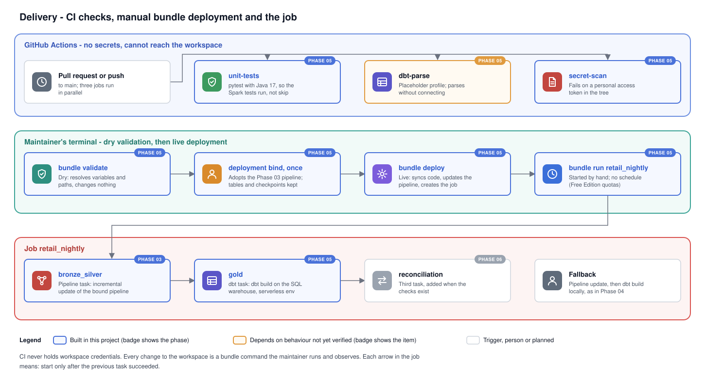

# Phase 05 Explanation: Orchestration and CI/CD

Status: complete. On 2026-11-01 the maintainer ran the workspace steps. The bundle was validated and deployed, the job ran to success with data unchanged, and CI passed on a pull request. Results are in `HANDOFF.md`.

## 1. Objectives

1. Describe the pipeline and an orchestration job as code, in a Declarative Automation Bundle (`databricks.yml`). The job runs bronze and silver, then gold.
2. Keep dry validation (`bundle validate`) separate from live deployment (`bundle deploy`), and keep both manual (ADR 0005).
3. Adopt the existing Phase 03 pipeline instead of creating a second one, so its tables and checkpoints are kept.
4. Run static checks and unit tests on every pull request and push with GitHub Actions, with no secrets (AC9).
5. State what Free Edition may not support, and keep the human-triggered path from Phases 03 and 04 as the fallback.

## 2. Files

| File | Purpose |
|---|---|
| `databricks.yml` | The bundle: variables, the pipeline, the job `retail_nightly`, one `dev` target |
| `.github/workflows/ci.yml` | CI: `unit-tests`, `dbt-parse` and `secret-scan` jobs |
| `tests/unit/test_bundle.py` | Static check: the job installs the dbt versions pinned in `requirements-dbt.txt` |
| `lakeflow/transformations/retail_pipeline.py` | Docstring only: settings now come from `databricks.yml` |
| `docs/diagrams/delivery.svg` | CI, manual deployment and the job in one picture |
| `docs/architecture.md`, `docs/adr/0005-...md`, `README.md` | Orchestration section, open questions, CI verification, status |

`lakeflow/pipeline.json` is unchanged. It is the record of how Phase 03 created the pipeline. From this phase, `databricks.yml` is the source of truth for the pipeline's settings. Section 5, D12, explains why the file is kept.

## 3. Flow



```
git push / pull request
  -> GitHub Actions: unit-tests | dbt-parse | secret-scan        (no workspace access)

maintainer's terminal, repository root, .env sourced
  databricks bundle validate                     dry: resolve and check, change nothing
  databricks bundle deployment bind ...          once: adopt the Phase 03 pipeline
  databricks bundle deploy                       live: sync files, update pipeline, create job
  databricks bundle run retail_nightly           start the job and wait

job retail_nightly
  bronze_silver   pipeline task, incremental update
    -> gold       dbt task: dbt build, only if bronze_silver succeeded
    -> (Phase 06) reconciliation
```

### 3.1 What the bundle deploys

`bundle deploy` does three things:
1. It uploads the repository's files to the bundle's folder in the workspace (`${workspace.file_path}`, under your user's `.bundle/spark_to_databricks_migration/dev/files`). Git-ignored files are expected to be left out (V14), so `.env`, `profiles.yml`, `data/raw/` and `output/` stay local.
2. It updates the bound pipeline to the settings in `databricks.yml`. The pipeline code now comes from the synced `lakeflow/transformations/` folder, and `retail.code_root` and `retail.contract_path` point into the same synced folder.
3. It creates the job `retail_nightly`.

In development mode both names get the prefix `[dev <your short name>]`. Table names do not change: the pipeline still publishes to `workspace.retail_bronze` and `workspace.retail_silver`, and dbt still builds `workspace.retail_gold`.

### 3.2 The job

| Task | Type | Runs when | Does |
|---|---|---|---|
| `bronze_silver` | Pipeline task | Job starts | One incremental update of the pipeline, as the Start button would |
| `gold` | dbt task | `bronze_silver` succeeded | `dbt build` from the synced `dbt/` folder, against the SQL warehouse |

The `gold` task runs dbt Core on serverless job compute, in an environment that installs `dbt-core==1.12.6` and `dbt-databricks==1.13.0` (environment version 4, Python 3.12.3). Its SQL runs on the warehouse that the variable `warehouse_id` resolves to.

Because `warehouse_id` is set, the Jobs API does not accept `profiles_directory`. Databricks supplies the connection to dbt itself, so no `profiles.yml` and no token are involved. The job runs as the user who deployed it.

`dbt build` exits non-zero only on errors. The four expected warnings from Phase 04 do not fail the task.

## 4. Verification against the documentation

Checked on 2026-11-01. "Verified" means the documentation or the official template states it. "Confirmed by run" means the maintainer's run on 2026-11-01 showed it. "Assumed" means it is still unchecked, and the runbook step named checks it.

| ID | Item | Status | Source or check |
|---|---|---|---|
| V1 | The product is now called Declarative Automation Bundles, formerly Databricks Asset Bundles. The CLI commands are still `databricks bundle ...`. | Verified | Bundle resources reference and release notes |
| V2 | Pipeline resource fields `serverless`, `catalog`, `schema`, `channel`, `configuration`, `libraries` (`glob` with `include`), `lifecycle` | Verified | Bundle resources reference |
| V3 | A relative `glob` include in `databricks.yml` is translated to the synced files path | Confirmed by run | Step 3 printed `.../dev/files/lakeflow/transformations/**`, and the pipeline update found the code |
| V4 | `${workspace.file_path}` is the folder the bundle's files are synced to | Confirmed by run | Step 3 printed `.../dev/files/lakeflow` and the contract under `.../dev/files/data/contracts/` |
| V5 | `bundle deployment bind KEY RESOURCE_ID` supports pipelines (by UUID) and jobs, and binding does not recreate data | Verified | CLI bundle commands reference |
| V6 | `mode: development` prefixes names, sets pipelines to `development: true`, pauses schedules, enables concurrent runs unless `max_concurrent_runs` is set, and disables the deployment lock | Verified | Deployment modes page |
| V7 | `pipeline_task.pipeline_id`, and `full_refresh` defaults to an incremental update | Verified | Jobs API reference |
| V8 | `dbt_task` fields `project_directory`, `commands`, `warehouse_id`, `catalog`, `schema`. `profiles_directory` "can only be specified if no warehouse_id is specified". | Verified | Jobs API reference |
| V9 | With `warehouse_id` set, the profile Databricks supplies works with `profile: retail` in `dbt_project.yml` | Confirmed by run | The `gold` task succeeded with no profile file (Step 6) |
| V10 | `environments[].spec` with `environment_version` and `dependencies`, referenced by `environment_key` | Verified | The CLI's own `dbt-sql` bundle template |
| V11 | Environment version 4 is Python 3.12.3 and supported until August 2028 | Verified | Serverless environment versions page |
| V12 | A `lookup` variable with `warehouse:` resolves a warehouse name to its id, and fails if the name matches none or several | Verified | Bundle variables page |
| V13 | With no `workspace.host`, the CLI uses the profile named in `DATABRICKS_CONFIG_PROFILE` | Confirmed by run | Step 3 resolved the maintainer's user and workspace path |
| V14 | Bundle file sync skips git-ignored files | Confirmed by run | Step 5 listing: `.env.example` uploaded but not `.env`. No `data/raw`, and no `profiles.yml`, `target` or `logs` in `dbt/` |
| V15 | `actions/checkout@v7`, `actions/setup-python@v7` and `actions/setup-java@v6` (Temurin) are the current majors | Verified | Release pages of each action |
| V16 | `dbt parse` reads the profile but does not connect, so a placeholder token works | Confirmed by run | The `dbt-parse` job passed on the pull request with placeholder values |
| V17 | Serverless job compute on Free Edition can install packages from PyPI (FE14) | Confirmed by run | The `gold` task installed the pinned dbt packages and ran (Step 6) |

## 5. Decisions

**D1. One `databricks.yml` at the repository root.**
- **Alternatives:** the template layout, with `databricks.yml` plus `resources/*.yml`; or a bundle in its own subfolder.
- **Why this one:** the bundle root is the folder that gets synced. At the root, the pipeline code, the contract and the dbt project are all inside it, with no `sync.paths` configuration. Two resources fit comfortably in one file.
- **Trade-off:** the whole repository is uploaded, including `docs/` and `phases/`. These are a few megabytes of text, and they are harmless in the workspace.

**D2. Bind the existing pipeline rather than create a new one.**

| Option | Result |
|---|---|
| Let the bundle create a second pipeline | Two pipelines would publish the same tables. Lakeflow lets only one pipeline own a table, so the update fails, or the old pipeline has to be deleted first and every table rebuilt |
| Leave the pipeline outside the bundle; the job finds it with a `lookup: pipeline:` variable | Works, but the pipeline's settings stay in a hand-maintained JSON file and code upload stays manual |
| Bind it (chosen) | The bundle adopts the pipeline by id. Tables, history and Auto Loader checkpoints are kept, and from now on its settings change only through `bundle deploy` |

`bind` is a one-time step. `lifecycle.prevent_destroy: true` makes the CLI refuse any plan that would delete the pipeline, including `bundle destroy`. Deleting it can drop the tables it publishes.

**D3. Pipeline code comes from the bundle's synced files.** In Phase 03 the code was uploaded by hand with `workspace import-dir` to `/Workspace/Shared/...`, and the settings pointed there. Now `bundle deploy` uploads the same files and rewrites the paths to the synced folder.

The source files are unchanged, and so are the flow and table names. The checkpoints therefore stay valid: the next update reads only files it has not seen.

The old `/Workspace/Shared/spark-to-databricks-migration` folder is no longer used once Step 5 has run. Removing it is optional (runbook Step 9).

**D4. The dbt task uses `warehouse_id`, so Databricks supplies the connection.**
- **Alternative:** the template's approach. A committed `profiles.yml` for jobs reads `DBT_HOST` and `DBT_ACCESS_TOKEN`, which Databricks sets for dbt tasks, and the task names it with `profiles_directory`.
- **Why `warehouse_id`:** it needs no profile file, no `.gitignore` exception for `profiles.yml`, and no warehouse id in git.
- **Risk:** the profile name (V9). Fallback F2 below is the template's approach.

**D5. Two tasks, one run at a time, no schedule.**
- Reconciliation joins as a third task in Phase 06, when its checks exist.
- `max_concurrent_runs: 1`, because a pipeline accepts only one active update. Phase 03 showed what a second start returns ("An active update already exists").
- There is no schedule. Free Edition has compute quotas (FE13), and every run in this project should be one the maintainer starts and records.
- A schedule is three lines (`schedule:` with a cron expression), and development mode would pause it anyway (V6).

**D6. The pipeline task never runs a full refresh.** A full refresh is a recovery action (architecture section 12), not a routine one. When needed, it is run on purpose, with `databricks bundle run retail_bronze_silver --full-refresh-all`.

**D7. One target, `dev`, in development mode.**
- Free Edition is one workspace, with no second environment to promote to.
- Production mode would need `run_as` and permissions, and it would refuse a pipeline in development mode (V6). That is the right check for a real production target, and pointless here.
- The production hardening table in `docs/case_study.md` describes the target a real deployment would add.

**D8. No host or warehouse id in git.**
- The host comes from the CLI profile in `.env` (V13).
- The warehouse is looked up by name (V12). "Serverless Starter Warehouse" is the name Free Edition gives its warehouse (FE8). Override it with `--var warehouse_id=<id>` if yours differs.

**D9. CI runs three independent jobs.**
- **`unit-tests`:** all of `tests/`. Java 17 is installed so the Spark tests (legacy job, Lakeflow rules) run instead of being skipped. `-rs` prints the reason for any skip, so a silently skipped Spark test shows in the log. Python is 3.12: it is supported by every pinned package, and is what dbt and the serverless environment use. Locally `.venv` is 3.15, so CI also checks that nothing depends on the newer interpreter.
- **`dbt-parse`:** compiles the dbt project with a placeholder profile. It catches broken Jinja, bad `ref()` or `source()` names and invalid YAML before anything reaches the warehouse.
- **`secret-scan`:** fails if a personal access token (`dapi` followed by 16 or more letters and digits) is in the checked-out tree. It complements the scan before each push. It checks the current tree only, not history.

**D10. No linter yet.** ADR 0005 mentions linting.
- Adding one (for example `ruff`) means a new dependency and an agreed rule set.
- The existing code has never been linted, so the first CI run would most likely fail on findings unrelated to this phase.
- It is a short, separate change once the maintainer chooses the rules.

**D11. No deployment from GitHub, and no GitHub secrets.** This follows ADR 0005. If a deploy workflow is added later, it must be its own workflow:
- triggered manually (`workflow_dispatch`)
- gated by a GitHub environment with required reviewers
- authenticated as a service principal, not a person

The safest form uses OIDC workload identity federation, so no long-lived secret is stored at all. Whether Free Edition supports service principals and federation is not verified. The fallback is an environment secret holding a short-lived token, scoped to that environment only.

Never put workspace credentials in repository-level secrets, which every workflow can read. Never print them in logs.

**D12. `lakeflow/pipeline.json` is kept.**
- The Phase 03 runbook creates the pipeline from it. Deleting the file would make that runbook impossible to follow.
- The pipeline is now changed only through `databricks.yml`. The two files differ only in the code paths, which is the point of D3.
- Phase 07 can remove `pipeline.json` when the runbooks are consolidated.

## 6. Dry validation versus live deployment

| | `bundle validate` | `bundle deploy` | `bundle run` |
|---|---|---|---|
| Changes the workspace | No | Yes: files, pipeline settings, job | Starts a run |
| Needs authentication | Yes. It resolves `lookup` variables and the user's paths | Yes | Yes |
| Can run in CI | Only with a credential, so not here (ADR 0005) | No | No |
| Who runs it | Maintainer | Maintainer, after validate | Maintainer |

`validate` is the dry run: it resolves every variable and path and prints the result without changing anything. The runbook also prints the resolved pipeline and job settings, so they can be checked before the first `deploy`.

`deploy --fail-on-active-runs` refuses to change the pipeline while an update is running.

## 7. Free Edition limits and fallbacks

| Item | If it fails | Fallback |
|---|---|---|
| FE12: bundle deploy | `deploy` errors | **F1.** Create the job in the UI from the settings in `databricks.yml` section `jobs`, and keep updating the pipeline by hand as in Phase 03. The bundle stays as documentation. |
| FE10: dbt task type, or V9 or V17 | `gold` task fails at setup | **F2.** Use the template's profile. Add `dbt/job_profiles/profiles.yml` with `host: "{{ env_var('DBT_HOST') }}"`, `token: "{{ env_var('DBT_ACCESS_TOKEN') }}"`, `http_path: /sql/1.0/warehouses/{{ var('warehouse_id') }}`. Allow it in `.gitignore` with `!dbt/job_profiles/profiles.yml`. In the task, replace `warehouse_id`, `catalog` and `schema` with `profiles_directory: job_profiles`, and use `dbt build --vars '{warehouse_id: ${var.warehouse_id}}'`. **F3.** If dbt cannot run in a job at all, remove the `gold` task and run `dbt build` locally after the job, as in Phase 04. |
| FE9: job quotas | Run queued or refused | Run the two steps by hand, as in Phases 03 and 04 |
| V16: `dbt parse` connects | `dbt-parse` job fails with a connection error | Remove that job. Compiling is then checked locally by `dbt build` |
| Actions versions | `Unable to resolve action` | Lower the major version in `ci.yml` |

Every fallback runs the same logic in the same order. Only the trigger and the place dbt runs change.

## 8. Failure modes

| Symptom | Cause | Fix |
|---|---|---|
| `validate`: no warehouse named "Serverless Starter Warehouse" | Warehouse renamed | `--var warehouse_id=<id>` on each command, or change the lookup name |
| `deploy`: "table is already managed by pipeline ..." | Step 4 (bind) skipped, so the bundle created a second pipeline | Do not run that pipeline. Remove it with `databricks pipelines delete <new id>`, after checking it is the new, empty one, then bind and deploy again |
| `deploy` refused: active run | An update is running | Wait for it to finish (Phase 03 wait loop), deploy again |
| Pipeline update fails: `No such file` for the contract or `ModuleNotFoundError: retail_rules` | `${workspace.file_path}` or sync differs from V4 or V14 | Paste the configuration from `databricks pipelines get` and the update error |
| `gold` fails: `Could not find profile named 'retail'` | V9 | Fallback F2 |
| `gold` fails installing packages | No PyPI access (V17) or environment version 4 unavailable | Try `environment_version: "3"`. If it still fails, fallback F3 |
| CI `unit-tests`: Spark tests skipped | Java not found | Check the `setup-java` step log |

## 9. Limitations

- Nothing in CI touches the workspace. Integration with Databricks is proven only by the manual runs in the runbook.
- The job has no alerts, retries or timeouts. Each is one field in the job, and none adds value while every run is started and watched by hand.
- The secret scan in CI covers one token format and the current tree only.
- Development mode adds a name prefix. The UI shows `[dev <user>] retail_bronze_silver` from now on, and that is expected.

## 10. Production hardening (not built)

- A `prod` target in production mode, in its own workspace or catalog, deployed by a service principal through a gated workflow (D11).
- `run_as` a service principal, with grants on the schemas and the warehouse.
- Job email or webhook notifications on failure, a `timeout_seconds`, and retries on the pipeline task.
- A file-arrival trigger on the landing volume instead of manual runs.
- CI deploys to a test workspace on merge and runs the validation queries there.
