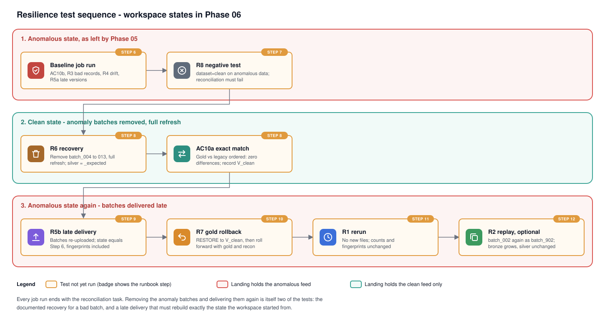

# Phase 06 Explanation: Reconciliation and Resilience

Status: complete (2026-11-01). All runbook steps were run, and the results are in the HANDOFF run log.
- Three failures came up during the runs, and each is fixed:
  - reading the manifests (section 4.5)
  - the exit call (section 4.4)
  - duplicate results when a failed task ran twice (section 4.4)
- In the clean state, gold equals legacy `ordered` exactly on all three marts (I1).
- The negative test failed the run as designed.

The predictions below are kept as they were written. Where a result was observed, it is marked so.

## 1. Objectives

1. Prove that the Lakehouse reproduces the legacy job's business outputs (AC10):
   - exactly, on data where the legacy job is not wrong by design
   - and with every difference explained by a documented cause, where it is
2. Run the comparison as the third task of `retail_nightly`, so every job run checks its own gold output. The maintainer chose this in the Phase 06 approval.
3. Execute and record a resilience test matrix (AC11): reruns, a replayed batch, bad records, schema drift, late arrivals, recovery and rollback.
4. Keep the evidence honest. The runbook collects outputs, and nothing is marked passed until the maintainer has run it.

## 2. Files

| File | Purpose |
|---|---|
| `reconciliation/reconcile.py` | Reconciliation engine and job entry point (PySpark) |
| `reconciliation/__init__.py` | Empty; makes `python -m reconciliation.reconcile` and the tests work |
| `reconciliation/sql/01_latest_results.sql` | SQL editor: latest run's summary and differences |
| `reconciliation/sql/02_legacy_vs_gold.sql` | SQL editor: independent cross-check of counts, keys and hashes |
| `reconciliation/sql/03_gold_metric_views.sql` | SQL editor: lets `legacy_spark/sql/baseline_metrics.sql` run over gold |
| `tests/unit/test_reconcile.py` | 5 tests on local Spark, using the legacy job on the committed samples |
| `tests/unit/test_bundle.py` | One new test: every `python_file` in the job exists |
| `databricks.yml` | Job parameter `dataset`, task `reconciliation`, environment `reconciliation` |
| `docs/diagrams/resilience-sequence.svg` | The order in which the workspace tests move between states |
| `docs/diagrams/reconciliation.svg`, `delivery.svg`, `phase-plan.svg` | Updated |
| `docs/architecture.md`, `README.md` | Audit schema, reconciliation and recovery sections, status |

## 3. What is compared with what

### 3.1 Three legacy outputs

The legacy job (Phase 02) has run on three local datasets, all generated with seed 42. They have the same final state: 530 customers, 50 products, 5,300 orders, 10,885 items and 5,901 payments.

| Legacy output | Input | Is the legacy job correct on it? |
|---|---|---|
| `output/legacy/ordered` | Every version delivered in its own window: no late arrivals, no replays | Yes. Last file wins picks the newest version, and nothing is delivered twice (Phase 02 EXPLANATION section 5) |
| `output/legacy/clean` | The clean feed: 13 late arrivals, 13 replays | No. It applies late versions by file order (L3) and counts replayed items and payments twice (L4) |
| `output/legacy/anomalous` | The clean feed plus `batch_004` to `batch_013`, one anomaly scenario each | No. L3 and L4, plus every anomaly the job does not reject (L5, L7) |

The ordered dataset has the same final state because `generate.py` builds the whole history before it decides which deliveries are late or replayed (`_deliver`). Setting both rates to 0 changes only the delivery, not the records.

### 3.2 Two states of the workspace

The landing folder can hold the clean feed or the anomalous feed. The job parameter `dataset` tells the task which one. Each state runs two comparisons:

| `dataset` | Comparison | Allowed causes | What it proves |
|---|---|---|---|
| `clean` | gold vs legacy `ordered` | none | **Exact match:** the Lakehouse computes the same marts as a correct run of the legacy rules (AC10, first half) |
| `clean` | gold vs legacy `clean` | clean-feed late arrivals and replays | The legacy job's errors on the clean feed are exactly the ones its limitations predict |
| `anomalous` | gold vs legacy `ordered` | only the scenarios the manifest says change silver | Bad records never reach gold. Gold moves only where valid new data arrived (`invalid_reference`, `payment_mismatch`) |
| `anomalous` | gold vs legacy `anomalous` | clean feed and every scenario | Every legacy versus Lakehouse difference has a documented cause (AC10, second half) |

The landing folder in the workspace also holds `batch_900`, a copy of `batch_002` added by the Phase 03 replay test. The legacy outputs were built without it. The Lakehouse ignores replays, so it changes nothing on the modern side and does not need to be removed.

The Phase 05 bronze counts (574 customers) match a landing folder without `batch_901`, the second replay planned in Phase 03 Step 11a. Runbook Step 4 lists the folder to settle this. The reconciliation does not depend on it either way.

## 4. How the reconciliation works

### 4.1 Reading

| Side | Source | Typing |
|---|---|---|
| Legacy | `<legacy root>/<dataset>/<mart>/part-*.csv` | Every column cast to the mart's type: dates, `bigint` counts, `DECIMAL(18,2)` money |
| Modern | `workspace.retail_gold.mart_<mart>` (job) or a CSV folder (local rehearsal) | Same casts |

The column types are listed once, in `MARTS`. Casting the legacy doubles to `DECIMAL(18,2)` is safe because the job rounded them to two places when writing (L8).

### 4.2 Comparing one mart

1. **Collapse each side to one row per key.** Count the rows, sum the measures and keep the minimum of other columns. A duplicate key is still reported (step 4). Summing keeps the totals comparable, which matters for the legacy null-date rows: there are three of them (Phase 02 section 5.1).
2. **Hash each collapsed row:** SHA-256 over every non-key column, with nulls written as a marker.
3. **Full outer join on the key,** using `<=>` (`eqNullSafe`) so null keys match each other. The legacy job produces null keys: a null customer id and null business dates.
4. **Give each key a kind,** in this order:
   - `missing_in_modern`, `missing_in_legacy`
   - `duplicate_in_modern`, `duplicate_in_legacy`
   - `value_mismatch` (hashes differ)
   - for a mismatch, `columns` lists the columns that differ
5. **Totals:** the row count and the sum of every numeric column on each side, printed when they differ.

### 4.3 Explaining a difference

A difference is explained when its key is touched by an allowed cause. The causes come from the manifests, not from hard-coded numbers:
- **Clean feed (`feed:late_arrival`, `feed:replay`):** `_manifest.json` lists each late arrival and replay with its entity and key.
- **Anomaly scenarios (`anomaly:<scenario>`):** every row in the scenario's batch, as listed in `_anomaly_manifest.json`. Using the whole batch also covers scenarios whose manifest ids are not event ids, such as `payment_mismatch`, which lists orders.

A cause names source records. `touched_keys` turns them into mart keys, using every version of each record found in the landing files:

| Source record | `daily_sales` keys | `customer_lifetime_value` keys | `product_performance` keys |
|---|---|---|---|
| Order | Its order dates, in every version (null when a version's date does not parse) | Its customer | Products on its items |
| Item | Its order's dates | Its order's customer | Its own product |
| Payment | Its payment date | Its order's customer (through any version that has an order id) | None |
| Customer, product | None | The customer's own key, which may be null | The product's own key |

"Every version" is what makes this work. A malformed timestamp is a bad version of a good order: the bad version gives the null date where the legacy job puts it, and the good versions give the real date it moved away from. Both are touched.

The business date uses the same arithmetic as `dbt/macros/business_date.sql`: epoch seconds plus eight hours, divided by a day. It parses with `try_to_timestamp`, so a bad value gives a null instead of an error, and the session time zone plays no part.

**A gold duplicate is never explained.** It breaks the mart's grain, whatever touched the key.

### 4.4 Output and exit status

- **Printed report:** one line per comparison and mart, with rows, duplicates, missing keys, mismatches, explained and unexplained counts, then totals that differ and up to 20 unexplained differences.
- **Tables** (job only, `--results-schema`):
  - `retail_audit.reconciliation_summary`: one row per comparison and mart.
  - `retail_audit.reconciliation_differences`: one row per differing key, with both sides' values as JSON and the causes.

  `run_id` is the job run id. Each write first deletes that run id's rows, then appends, so a run has one set of results however many times its task executes.
  - **Why:** both failed job runs executed the task twice under the same run id (HANDOFF, Step 7), and the first version only appended. Each of those runs has two sets of rows, and the differences table has no `run_at` to tell them apart. A repaired run also keeps its run id.
  - **Alternatives:**
    - `max_retries: 0` on the task. The job sets no retries, so the second attempt does not come from the job settings, and this may not stop it.
    - A `MERGE` on the run id and key. It adds code, and its only gain over delete-then-append is atomicity, which an audit log of a finished run does not need.
  - **Trade-off:** the delete and the append are two commits. For a moment, a reader can see no rows for that run.
  - **Local tests:** they cannot cover this path. `DELETE` needs Delta, and the local session has no Delta. The workspace check is runbook Step 11b (V17).
- **Exit status:** `RESULT: PASS` and a normal end when no difference is unexplained. Otherwise `RESULT: FAIL` and a `RuntimeError`, which fails the task and the job run, and exits with status 1 locally.
  - **Why not `sys.exit()`:** the first version ended with `sys.exit(main())`. In the first job run, the task failed with `SystemExit: 0`, so the job runner treats any `SystemExit` as a failure, even with code 0. It printed `An exception has occurred, use %tb to see the full traceback`, which suggests the script runs inside an IPython-style shell. `main()` returning normally and an exception on failure work the same everywhere.
  - **Alternative:** `raise SystemExit(1)` on failure only. It also fails the task, but its message, `SystemExit: 1`, says less than the `RuntimeError` text.

### 4.5 Reading the manifests

The manifests are read with Python's `open()`, not Spark.

- **What went wrong first:** the first version read them with `spark.read.text(path, wholetext=True)`. In the first Step 3 rehearsal, Spark logged `All paths were ignored: .../_manifest.json` and returned no rows, so the script stopped with `TypeError: 'NoneType' object is not subscriptable`.
- **Why:** Spark's file listing treats names that start with `_` or `.` as hidden, which is how it skips `_SUCCESS`. That applies even to a file named explicitly. Both manifests start with `_`.
- **Why the tests missed it:** they loaded the anomaly manifest with `pathlib` and never called `main()`. `test_main_reads_the_manifests_and_passes_on_identical_outputs` now runs `main()` end to end.
- **Alternatives:**
  - Rename the manifests: they are Phase 01 generator outputs, and earlier phases use them by name.
  - Copy each manifest to a name without `_` before reading: one more upload step to forget.
- **Trade-off:** `open()` on a `/Volumes/...` path relies on the workspace's POSIX access to volumes (V16). The volumes documentation describes POSIX-style paths and the Python `os` module, but does not say that this works on serverless compute.

## 5. Invariants and acceptable differences

### 5.1 Invariants: must always hold

| ID | Invariant | Checked by |
|---|---|---|
| I1 | On the clean state, gold equals the legacy `ordered` output for every key and column | Reconciliation, exact comparison |
| I2 | On the anomalous state, gold differs from legacy `ordered` only on keys touched by scenarios that change silver | Reconciliation |
| I3 | Gold has no duplicate keys and no null business date | Reconciliation (gold duplicate always unexplained); dbt tests; gold check 12 |
| I4 | A rerun with no new files, a replayed batch, a full refresh and a late re-delivery all leave silver counts and fingerprints unchanged | `lakeflow/validation/01_layer_counts.sql` before and after |
| I5 | Quarantine counts equal the anomaly manifest | `lakeflow/validation/03_anomaly_checks.sql` |
| I6 | The three gross sales totals in gold are equal | `dbt/checks/04_gold_checks.sql` rows 7 and 8 |

### 5.2 Acceptable differences between legacy and gold

Each is a legacy limitation from Phase 02, and each has a cause name the reconciliation attaches to the key.

| Cause | Legacy behaviour | Effect on the legacy marts |
|---|---|---|
| `feed:replay` | Items and payments stacked twice (L4); master data re-applied by file order (L3) | Higher gross, items and charges on the affected dates, customers and products |
| `feed:late_arrival` | Older version applied last (L3) | A status, region or product attribute from an older version |
| `anomaly:duplicate_key_conflict` | Both payment copies stacked | Charges counted twice |
| `anomaly:null_required` | Null-id customers collapse to one row; orders with a null status stop being sold; payments with a null order id still count in daily charges | A legacy row with a null `customer_id`; lower sold counts; higher daily charges |
| `anomaly:invalid_reference` | Kept, as in gold | Present on both sides; differs only against `ordered` |
| `anomaly:negative_amount` | The negative copy is stacked | Those payments net to zero |
| `anomaly:payment_mismatch` | Kept, as in gold | Present on both sides; differs only against `ordered` |
| `anomaly:malformed_timestamp` | Unparseable dates become null | Three legacy rows with a null `business_date`, one per aggregate, and lower counts on the true dates |
| `anomaly:malformed_type` | Values that cast become extra lines; others become null | Small changes to items and gross |
| `anomaly:schema_evolution`, `late_arrival`, `replay` | Extra column ignored; shipped is still sold; identical copies | Normally none. A replay can still apply an older order version by file order |

A difference with no cause is a defect, either in the Lakehouse or in this table. It fails the run.

## 6. Expected results

Each prediction below comes from recorded numbers. If an observed number differs, that is a finding: record it, and don't adjust the expectation.

**Gold, anomalous state.** Recorded in Phase 05 Step 7:
- `mart_daily_sales`: 96 rows, 4,478 orders sold
- gross 2,646,546.91; charges 2,780,589.47; refunds 146,764.64; net 2,633,824.83
- silver has 530 customers and 50 products, so the other two marts have 530 and 50 rows

**Gold, clean state, and legacy `ordered`.** Predicted to be equal (I1). The anomalous gold above includes two scenarios that add valid rows:
- **invalid_reference:** 10 pending orders on 2026-01-06, and 50.00 of charges for an unknown order.
- **payment_mismatch:** 25.00 of extra charges on 2026-01-08.

Removing both gives:

| Measure | Predicted |
|---|---|
| `daily_sales` rows | 94 (96 minus those two dates; legacy clean also has 94, from 2025-10-03 to 2026-01-04) |
| orders placed | 5,300 |
| orders sold | 4,478 |
| gross sales | 2,646,546.91 |
| charges | 2,780,514.47 |
| refunds | 146,764.64 |
| net payments | 2,633,749.83 |
| `customer_lifetime_value` / `product_performance` rows | 530 / 50 |

Observed (runbook Step 8, run 755100707843223): gold in the clean state against legacy `ordered`, with no allowed causes, gave 94/94, 530/530 and 50/50 rows. It found no missing, duplicate or mismatched key on any mart, so I1 holds. The headline query for this state has not been recorded yet.

**Legacy `clean` against that.** Its recorded totals (Phase 02) are gross 2,646,985.28, charges 2,780,817.81 and 4,477 orders sold. The predicted differences are:
- **+438.37 gross:** replayed items counted twice.
- **+303.34 charges:** replayed payments counted twice.
- **−1 sold order:** a late older version applied by file order.

Runbook Step 2 (2026-11-01) recorded the legacy `ordered` totals exactly as predicted in the table above, so these three totals differences are now observed. The local rehearsal (runbook Step 3) then found 3 `daily_sales`, 7 customer and 7 product keys that differ, all touched by a clean-feed cause and none unexplained. Which cause produced each total is still an inference, because the report lists keys and causes but does not split the totals by cause.

**The comparison gold (anomalous) against legacy `ordered`:**
- `daily_sales`: two keys missing in legacy, 2026-01-06 and 2026-01-08.
- `customer_lifetime_value`: one value mismatch on `lifetime_net_paid` for each customer of a `payment_mismatch` order, so five or fewer.
- `product_performance`: none.
- All explained.

## 7. Resilience test matrix

The workspace steps run in the order shown in the diagram. Each state change is itself one of the tests:

| ID | Scenario | How it is triggered | Expected invariant | Acceptable difference | Runbook |
|---|---|---|---|---|---|
| R1 | Rerun with no new files | Job run with nothing new in landing | I4: silver counts and fingerprints identical; gold headline identical; reconciliation PASS | None | Step 11 |
| R2 | Replayed batch (optional) | `batch_002` uploaded again as `batch_902` | Bronze grows by the batch; silver identical (I4) | Bronze counts only | Step 12 |
| R3 | Bad records | Anomalous state | I5: 18 anomaly checks `ok`; I2: gold moves only for silver-changing scenarios | Legacy differences per section 5.2 | Step 6 |
| R4 | Schema drift | `batch_011` adds `loyalty_tier` | Bronze keeps it in `_rescued_data`; silver values unchanged (anomaly checks 17 and 18); no reconciliation difference caused by it | None in the marts | Step 6 |
| R5 | Late arrivals | (a) late versions in the feed and `batch_012`; (b) ten whole batches delivered after a rebuild | (a) silver ignores older versions (check 10); (b) the state after re-delivery equals the state before removal, fingerprints included (I4) | None | Steps 6 and 9 |
| R6 | Recovery from bad batches | Remove `batch_004` to `batch_013`, full refresh | Silver equals the generator's expected state (`02_silver_vs_expected.sql` all zero); gold equals legacy `ordered` exactly (I1) | None | Step 8 |
| R7 | Gold rollback | `RESTORE` `mart_daily_sales` to its clean-state version, then rebuild with dbt | After restore: the clean headline; after roll forward: the anomalous headline; reconciliation PASS | Gold temporarily behind silver, by design | Step 10 |
| R8 | Reconciliation catches a defect | Job run with `dataset=clean` while the workspace is anomalous | The task reports unexplained differences and fails the job run. The CLI exits with an error | The failure is the expected result | Step 7 |

R8 is the negative test. It shows that the task can fail and that a failure fails the job (V5). The unit test `test_every_difference_without_a_cause_is_unexplained` covers the same logic locally.

**R6 deliberately relaxes the landing rule** ("add files only", architecture section 3). Removing a bad batch and doing a full refresh is the documented recovery for a bad batch (architecture section 12). The removed folders are restored from `data/raw/anomalous` in R5. They are byte-identical, because the files are deterministic and listed with SHA-256 checksums in the manifest.

## 8. Verification against the documentation

Checked on 2026-11-01. "Verified" means the documentation states it. "Assumed" means the step named checks it.

| ID | Item | Status | Source or check |
|---|---|---|---|
| V1 | A Python script task (`spark_python_task`, `python_file`, `parameters`) runs on serverless compute when it names an `environment_key` | Verified | Bundle job task types page |
| V2 | `bundle run` takes `--params k=v` for job parameters and `--only` for a subset of tasks (a `+` suffix adds downstream tasks); it waits for the run | Verified | CLI bundle commands page |
| V3 | `{{job.parameters.<name>}}` and `{{job.run_id}}` can be used in a task's parameters | Verified | Dynamic value references page ("with any task") |
| V4 | The script runs as `__main__`, and `SparkSession.builder.getOrCreate()` returns the serverless session | Confirmed (2026-11-01): the Step 8 and 9 runs printed the report in the task output, and `01_latest_results.sql` read its rows from `retail_audit` | Step 6: the report is in the task output and rows are in `retail_audit` |
| V5 | An exception fails the task and the run. (Originally "a non-zero exit"; the first run showed that `SystemExit` fails the task whatever its code) | Confirmed (2026-11-01, Step 7): `RuntimeError` failed the `reconciliation` task, and the run ended `INTERNAL_ERROR FAILED` | Step 7 (R8) |
| V6 | An environment with only `environment_version` is accepted | Confirmed (2026-11-01): the bundle deployed, and the `reconciliation` task ran in that environment | Step 5 `validate` and `deploy` |
| V7 | Serverless Spark reads CSV from `/Volumes` paths | Confirmed (2026-11-01): the task read the legacy outputs and the landing files | Step 6 |
| V8 | The job's user can create `retail_audit` and append to tables there | Confirmed (2026-11-01): `01_latest_results.sql` returned the task's rows | The maintainer is in `admins` (Phase 03). Step 6 |
| V9 | `try_to_timestamp`, `unix_seconds` and `date_from_unix_date` exist in PySpark and on serverless | Confirmed (2026-11-01): the job runs computed business dates for the touched keys, which explained the date differences | Local tests (PySpark 4.3); Step 6 |
| V10 | `read_files` takes a `schema` option and a glob in the path | Confirmed (2026-11-01): `02_legacy_vs_gold.sql` ran and matched the task | Step 6, `02_legacy_vs_gold.sql` |
| V11 | Temporary views created in one SQL editor run are visible to later statements in the same run | Confirmed (2026-11-01): the metrics ran over the views | Step 6, metrics query |
| V12 | dbt's table materialisation keeps Delta history, so `RESTORE ... TO VERSION AS OF` works on a mart | Confirmed (2026-11-01): `DESCRIBE HISTORY` lists one `CREATE OR REPLACE TABLE AS SELECT` per dbt build, and `RESTORE ... TO VERSION AS OF 6` committed as version 8 | Step 10 `DESCRIBE HISTORY` |
| V13 | After files are removed from landing, a full refresh rebuilds from the files present only | Confirmed (2026-11-01): gold equalled legacy `ordered` exactly after the first Step 8. The maintainer reported that the repeated Step 8 gave the expected silver counts and an all-zero `02_silver_vs_expected.sql` | Step 8 |
| V14 | Files uploaded again at paths read before the full refresh are ingested as new, because the full refresh reset the checkpoint | Confirmed (2026-11-01): the Step 9 reconciliation counts equal Step 6. The maintainer reported that the repeated Step 9 gave counts and fingerprints identical to the state before removal | Step 9 |
| V15 | `databricks fs rm -r` removes a folder in a volume | Confirmed (2026-11-01): the Step 8 listing has no `batch_004` to `batch_013` | Step 8 listing |
| V16 | Python `open()` reads a `/Volumes/...` file from a serverless Python script task | Confirmed by the first job run (2026-11-01): the script read both manifests and reached its last line | Step 6 |
| V17 | `spark.catalog.tableExists` with a three-part name, and `spark.sql` with named parameters (`args`), work on serverless | Confirmed (2026-11-01): the Step 11b task ran twice and its run has 6 summary rows from 1 write | Step 11b |

## 9. Decisions

**D1. Compare key by key, not only totals.**
- **Alternative:** compare the Phase 02 baseline metrics (sums and counts).
- **Why key by key:** totals can net out. In Phase 02 the negative copies cancelled part of the duplicate charges. Per-key hashes find every row that differs, and the totals are still printed.
- **The metrics are kept anyway:** `03_gold_metric_views.sql` runs `baseline_metrics.sql` over gold, as Phase 02 planned.

**D2. Explain differences by the keys their causes touch.**

| Option | Problem |
|---|---|
| A ledger of expected numbers per scenario | Tied to one seed and count; must be recomputed by hand whenever data changes |
| Re-implement the legacy rules to predict the legacy output exactly | A second copy of the legacy logic, which is the thing under test |
| Touched keys from the manifests and landing files (chosen) | Data-driven and seed-independent; works for any scenario selection |

- **Trade-off:** a genuine defect on a key that a cause also touches would be counted as explained.
- **Mitigation:** the exact comparison (I1) has no causes at all. The anomalous comparison against `ordered` allows only the two scenarios that change silver.

**D3. The exact match uses the legacy `ordered` output.** AC10 asks for an exact match on clean data, but on the clean feed the legacy job is wrong by design (L3, L4). An exact match there would mean the Lakehouse copies the legacy bugs. The ordered dataset has the same final state and no late or replayed deliveries, so it is the correct legacy result.

**D4. Get the clean state by removing the anomaly batches and running a full refresh.**

| Option | Cost |
|---|---|
| A second pipeline and second set of schemas for clean data | A new pipeline, schemas and dbt target; doubles the setup |
| Compute "clean gold" from anomalous gold by subtracting known effects | Re-derives the answer instead of measuring it |
| Remove, full refresh, measure, re-deliver (chosen) | Two extra updates; landing changes temporarily |

The chosen route doubles as tests R6 and R5, the documented recovery and a late delivery.

**D5. The task is a PySpark script.**
- **Alternatives:**
  - a SQL file task on the warehouse: simple, but hard to unit test, and classification in SQL is long
  - a notebook task: needs its own environment cell, and is harder to test
- **Why a script:** the same file runs in the job, in the local rehearsal and in CI, where Java is installed. `02_legacy_vs_gold.sql` is a second, independent implementation of the counts in SQL. When both agree, a bug in either is unlikely.

**D6. Results go to a new schema, `retail_audit`.**
- **Alternatives:**
  - only the task log: lost when the run is purged, and hard to query
  - JSON files in a volume: not queryable
- **Why a schema:** tables can be queried in the SQL editor and keep every run.
- **Ownership:** the reconciliation task is the only writer. It never writes to `retail_bronze`, `retail_silver` or `retail_gold` (ADR 0001, AC8).
- **Creation:** the script creates the schema if it does not exist. That is one statement; nothing else needs to be set up first.

**D7. Legacy outputs live in the existing landing volume, under `raw/legacy/`.**
- The pipeline reads only `raw/retail/batch_*/`, so `raw/legacy/` is never ingested.
- A separate volume would be cleaner, but adds a resource for a few hundred kilobytes.

**D8. One job parameter, `dataset`, default `anomalous`.**
- The landing folder normally holds the anomalous feed.
- A wrong value fails loudly, which is R8.

**D9. Duplicate keys are summed, not dropped.** Dropping one row would hide part of a total. Summing keeps the totals right, and the duplicate is still reported as a difference.

**D10. A failed reconciliation fails the run, and nothing downstream is blocked.** Reconciliation is the last task. Its failure marks the run failed, which is the signal a scheduler or alert would use in production.

## 10. Failure modes

| Symptom | Likely cause | Fix |
|---|---|---|
| Local rehearsal: path does not exist | Legacy outputs or `data/raw/ordered` missing | Runbook Step 2 regenerates them |
| Task fails: path does not exist under `/Volumes/.../legacy/...` | Upload step skipped, or `fs cp` nested a folder | Runbook Step 4 listing |
| Task fails: `_anomaly_manifest.json` not found | The manifest was not uploaded to landing | Runbook Step 4 |
| Task fails: `FileNotFoundError` or `PermissionError` on a manifest that Step 4 lists | V16: no Python file access to volumes on this compute | Paste the error. Fallback: upload copies of the manifests under names without the leading `_` and read those through Spark (section 4.5) |
| Task output has no report, and no rows appear in `retail_audit` | V4: the script did not run as `__main__` | Paste the task output. Fallback: wrap the script in a notebook task that calls `main([...])` |
| Unexplained differences in the exact comparison | A real difference between dbt and the legacy rules, or a wrong prediction in section 6 | Paste the unexplained lines and `01_latest_results.sql`. This is a finding, not something to tune away |
| Unexplained differences against legacy `anomalous` only | A cause missing from section 5.2, or a touch rule that is too narrow | Paste the differences. Each needs a cause before the run can pass |
| Task fails in `write_results` on `tableExists` or `DELETE` | V17 | Paste the error. Fallback: `spark.sql(f"DELETE ... WHERE run_id = '{run_id}'")` inside `try`, since the job's run id is digits only |
| `RESTORE` refused, or history shows one version | V12: the mart is dropped and recreated | Record it. Rollback is then "rebuild from silver with dbt", which R7's roll forward already shows |
| After R5, fingerprints differ from Step 6 | Re-uploaded files differ, or were not all ingested | Compare `fs ls` of landing with Step 6; check the manifest checksums locally |

## 11. Limitations

- **Coverage of causes:** a cause excuses every difference on the keys it touches. Section 9 (D2) explains the trade-off and the two comparisons that limit it.
- **Legacy outputs reach the workspace by hand.** In production, both systems would run on the same schedule against the same delivered files.
- **Test data:** the resilience matrix uses the small preset and one seed. It shows the mechanisms; it does not measure behaviour at scale.
- **Workspace state:** R6 and R5 change the landing folder temporarily. A step done out of order leaves it in the clean state; the runbook says how to get back.
- **Silver history:** the pipeline's streaming tables refused `TIMESTAMP AS OF` (2026-11-01). A past silver state cannot be queried later; it has to be measured while it lasts. The gold marts are ordinary Delta tables and do keep queryable history (V12).
- **Timing:** nothing here measures performance. Phase 07 handles timing, with recorded runs only.

## 12. Production hardening (not built)

- Reconciliation against the source system's own control totals, not only against a legacy job that is due to be retired.
- Alerts on a failed reconciliation task, and a dashboard over `retail_audit`.
- A retention policy for `retail_audit`, and grants so only the job's service principal can write to it.
- A parallel-run period: both systems scheduled daily, reconciled daily, with a sign-off rule before the legacy job is switched off.
